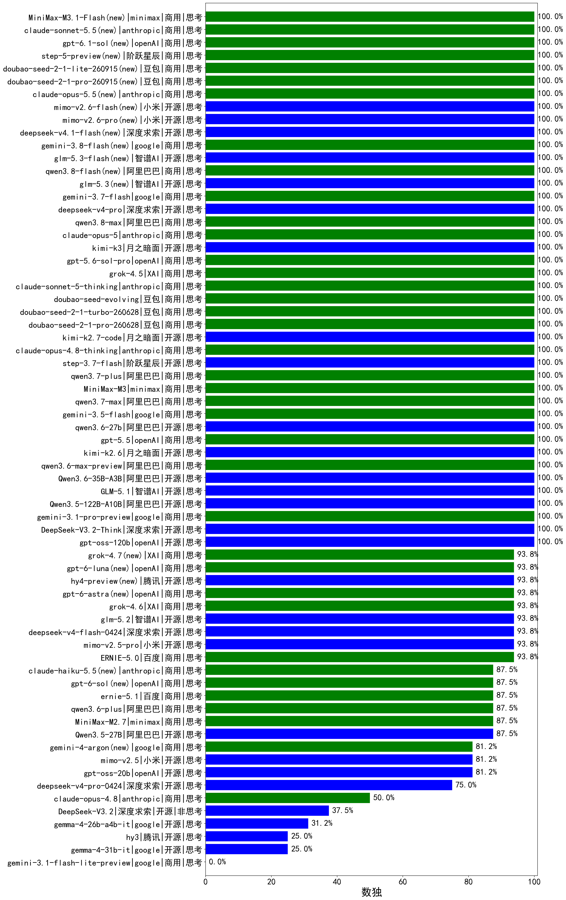

|类别|机构|大模型|【数独】准确率|平均耗时|平均消耗token|花费/千次（元）|排名（准确率）|
|---|---|-----|-------------------|-------|-----------|-----------|-----------|
|开源|openAI|gpt-oss-120b|100.0%|424s|4920|15.7|1|
|开源|阶跃星辰|step-3.7-flash|100.0%|135s|18021|145.3|2|
|开源|月之暗面|kimi-k2.7-code|100.0%|174s|6892|184.2|3|
|商用|豆包|doubao-seed-2-1-pro-260628|100.0%|446s|24241|723.3|4|
|商用|豆包|doubao-seed-evolving|100.0%|503s|25060|747.9|5|
|商用|anthropic|claude-sonnet-5-thinking|100.0%|102s|12320|856.2|6|
|商用|XAI|grok-4.5|100.0%|208s|10178|419.3|7|
|商用|openAI|gpt-5.6-sol-pro|100.0%|50s|13835|1546.3|8|
|开源|月之暗面|kimi-k3|100.0%|170s|6107|597.1|9|
|商用|anthropic|claude-opus-5|100.0%|43s|3850|658.3|10|
|商用|阿里巴巴|qwen3.8-max|100.0%|117s|6398|226.4|11|
|开源|深度求索|deepseek-v4-pro|100.0%|161s|11679|312.3|12|
|商用|google|gemini-3.7-flash|100.0%|36s|5034|129.7|13|
|开源|智谱AI|glm-5.3(new)|100.0%|146s|5547|153.0|14|
|商用|阿里巴巴|qwen3.8-flash(new)|100.0%|89s|7153|19.0|15|
|开源|智谱AI|glm-5.3-flash(new)|100.0%|103s|5321|14.7|16|
|商用|google|gemini-3.8-flash(new)|100.0%|28s|5646|291.5|17|
|开源|深度求索|deepseek-v4.1-flash(new)|100.0%|102s|7865|62.2|18|
|开源|小米|mimo-v2.6-pro(new)|100.0%|136s|10928|65.2|19|
|开源|小米|mimo-v2.6-flash(new)|100.0%|220s|9180|18.2|20|
|商用|anthropic|claude-opus-5.5(new)|100.0%|38s|2459|331.7|21|
|商用|豆包|doubao-seed-2-1-pro-260915(new)|100.0%|317s|14714|437.5|22|
|商用|豆包|doubao-seed-2-1-lite-260915(new)|100.0%|112s|6166|16.4|23|
|商用|阶跃星辰|step-5-preview(new)|100.0%|66s|7017|139.1|24|
|商用|openAI|gpt-6.1-sol(new)|100.0%|137s|1387|92.0|25|
|商用|anthropic|claude-sonnet-5.5(new)|100.0%|23s|2985|202.6|26|
|商用|minimax|MiniMax-M3.1-Flash(new)|100.0%|59s|6071|23.4|27|
|商用|anthropic|claude-opus-4.8-thinking|100.0%|64s|6573|1134.8|28|
|商用|豆包|doubao-seed-2-1-turbo-260628|100.0%|472s|17417|259.3|29|
|商用|阿里巴巴|qwen3.7-plus|100.0%|153s|8243|65.2|30|
|商用|openAI|gpt-5.5|100.0%|34s|3283|673.7|31|
|开源|深度求索|DeepSeek-V3.2-Think|100.0%|629s|16343|48.9|32|
|商用|google|gemini-3.1-pro-preview|100.0%|143s|10387|876.7|33|
|开源|阿里巴巴|Qwen3.5-122B-A10B|100.0%|1077s|13344|84.7|34|
|商用|minimax|MiniMax-M3|100.0%|437s|19876|330.7|35|
|开源|阿里巴巴|Qwen3.6-35B-A3B|100.0%|258s|19126|205.4|36|
|商用|阿里巴巴|qwen3.6-max-preview|100.0%|224s|8495|453.1|37|
|开源|月之暗面|kimi-k2.6|100.0%|517s|11583|310.9|38|
|开源|智谱AI|GLM-5.1|100.0%|278s|10692|254.7|39|
|开源|阿里巴巴|qwen3.6-27b|100.0%|282s|19578|350.5|40|
|商用|google|gemini-3.5-flash|100.0%|41s|10138|632.5|41|
|商用|阿里巴巴|qwen3.7-max|100.0%|129s|8641|308.0|42|
|开源|月之暗面|kimi-k3.1-pro(new)|100.0%|137s|5666|376.0|43|
|商用|openAI|gpt-6-luna(new)|93.8%|96s|4696|16.2|44|
|商用|XAI|grok-4.6|93.8%|224s|11406|470.9|45|
|商用|百度|ERNIE-5.0|93.8%|886s|17946|428.8|46|
|开源|小米|mimo-v2.5-pro|93.8%|257s|15942|329.6|47|
|开源|智谱AI|glm-5.2|93.8%|271s|13091|364.3|48|
|商用|openAI|gpt-6-astra(new)|93.8%|36s|1245|410.4|49|
|开源|深度求索|deepseek-v4-flash-0424|93.8%|241s|17224|34.4|50|
|开源|腾讯|hy4-preview(new)|93.8%|79s|7158|127.6|51|
|商用|XAI|grok-4.7(new)|93.8%|195s|17652|704.2|52|
|商用|anthropic|claude-haiku-5.5(new)|87.5%|26s|6210|21.4|53|
|开源|阿里巴巴|Qwen3.5-27B|87.5%|367s|18227|87.0|54|
|商用|openAI|gpt-6-sol(new)|87.5%|344s|2190|148.2|55|
|商用|阿里巴巴|qwen3.6-plus|87.5%|385s|24702|295.2|56|
|商用|minimax|MiniMax-M2.7|87.5%|378s|18925|158.2|57|
|商用|百度|ernie-5.1|87.5%|149s|7120|126.6|58|
|开源|openAI|gpt-oss-20b|81.2%|450s|8299|9.5|59|
|商用|google|gemini-4-argon(new)|81.2%|48s|2252|300.2|60|
|开源|小米|mimo-v2.5|81.2%|145s|16539|227.4|61|
|开源|深度求索|deepseek-v4-pro-0424|75.0%|283s|13198|315.7|62|
|商用|anthropic|claude-opus-4.8|50.0%|34s|2221|373.2|63|
|开源|深度求索|DeepSeek-V3.2|37.5%|273s|5758|17.2|64|
|开源|google|gemma-4-26b-a4b-it|31.2%|100s|1797|4.8|65|
|开源|google|gemma-4-31b-it|25.0%|332s|1400|3.7|66|
|开源|腾讯|hy3|25.0%|76s|2699|10.5|67|
|商用|google|gemini-3.1-flash-lite-preview|0.0%|26s|829|7.7|68|

