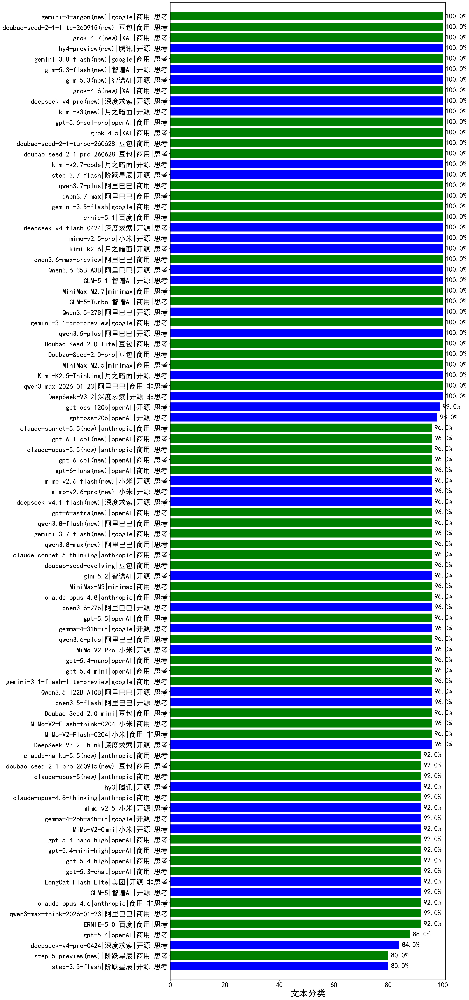

|类别|机构|大模型|【文本分类】准确率|平均耗时|平均消耗token|花费/千次（元）|排名（准确率）|
|---|---|-----|-------------------|-------|-----------|-----------|-----------|
|商用|豆包|doubao-seed-2-1-pro-260628|100.0%|311s|5210|154.1|1|
|开源|月之暗面|kimi-k2.7-code|100.0%|16s|689|17.7|2|
|商用|阿里巴巴|qwen3.7-plus|100.0%|15s|749|5.7|3|
|商用|豆包|doubao-seed-2-1-turbo-260628|100.0%|70s|2190|31.7|4|
|商用|XAI|grok-4.5|100.0%|38s|964|33.4|5|
|商用|阿里巴巴|qwen3.7-max|100.0%|18s|925|32.1|6|
|商用|google|gemini-3.5-flash|100.0%|6s|934|56.2|7|
|商用|百度|ernie-5.1|100.0%|41s|523|8.7|8|
|商用|openAI|gpt-5.6-sol-pro|100.0%|7s|2407|152.3|9|
|开源|月之暗面|kimi-k3|100.0%|67s|1332|123.3|10|
|开源|深度求索|deepseek-v4-pro|100.0%|654s|848|20.7|11|
|开源|深度求索|deepseek-v4-flash-0424|100.0%|29s|1533|3.0|12|
|开源|小米|mimo-v2.5-pro|100.0%|12s|860|13.9|13|
|商用|XAI|grok-4.6|100.0%|19s|1130|40.4|14|
|开源|月之暗面|kimi-k2.6|100.0%|48s|765|19.7|15|
|商用|阿里巴巴|qwen3.6-max-preview|100.0%|31s|1006|52.1|16|
|开源|阿里巴巴|Qwen3.6-35B-A3B|100.0%|7s|1038|10.8|17|
|开源|智谱AI|GLM-5.1|100.0%|113s|733|16.8|18|
|开源|智谱AI|glm-5.3(new)|100.0%|19s|557|14.5|19|
|开源|智谱AI|glm-5.3-flash(new)|100.0%|29s|864|2.3|20|
|商用|google|gemini-3.8-flash(new)|100.0%|20s|730|36.2|21|
|商用|minimax|MiniMax-M2.7|100.0%|19s|673|5.2|22|
|开源|腾讯|hy4-preview(new)|100.0%|42s|2767|49.1|23|
|商用|XAI|grok-4.7(new)|100.0%|9s|1835|41.0|24|
|开源|阿里巴巴|Qwen3.5-27B|100.0%|336s|2400|11.3|25|
|商用|google|gemini-3.1-pro-preview|100.0%|62s|1024|83.7|26|
|商用|豆包|doubao-seed-2-1-lite-260915(new)|100.0%|70s|2931|7.8|27|
|商用|google|gemini-4-argon(new)|100.0%|36s|250|26.5|28|
|开源|深度求索|DeepSeek-V3.2|100.0%|77s|264|0.8|29|
|开源|阶跃星辰|step-3.7-flash|100.0%|18s|1061|8.2|30|
|开源|openAI|gpt-oss-120b|99.0%|2s|478|1.3|31|
|开源|openAI|gpt-oss-20b|98.0%|3s|584|0.6|32|
|商用|阿里巴巴|qwen3.6-plus|96.0%|46s|1274|14.8|33|
|商用|阿里巴巴|qwen3.8-flash(new)|96.0%|7s|320|0.7|34|
|开源|阿里巴巴|Qwen3.5-122B-A10B|96.0%|296s|1960|12.3|35|
|商用|openAI|gpt-6-sol(new)|96.0%|59s|169|8.3|36|
|商用|openAI|gpt-6-luna(new)|96.0%|124s|237|0.7|37|
|开源|小米|mimo-v2.6-flash(new)|96.0%|20s|695|1.3|38|
|开源|小米|mimo-v2.6-pro(new)|96.0%|111s|456|2.6|39|
|商用|google|gemini-3.1-flash-lite-preview|96.0%|4s|161|1.3|40|
|开源|深度求索|deepseek-v4.1-flash(new)|96.0%|30s|2836|22.3|41|
|商用|openAI|gpt-6-astra(new)|96.0%|14s|184|46.9|42|
|开源|智谱AI|glm-5.2|96.0%|20s|889|23.8|43|
|开源|google|gemma-4-31b-it|96.0%|28s|136|0.3|44|
|商用|google|gemini-3.7-flash|96.0%|4s|701|17.4|45|
|商用|openAI|gpt-6.1-sol(new)|96.0%|6s|147|6.8|46|
|商用|anthropic|claude-sonnet-5.5(new)|96.0%|6s|464|27.4|47|
|商用|阿里巴巴|qwen3.8-max|96.0%|40s|1662|57.7|48|
|开源|深度求索|DeepSeek-V3.2-Think|96.0%|165s|1255|3.7|49|
|商用|openAI|gpt-5.5|96.0%|18s|229|37.0|50|
|开源|阿里巴巴|qwen3.6-27b|96.0%|25s|1290|22.5|51|
|商用|anthropic|claude-opus-4.8|96.0%|8s|407|59.0|52|
|商用|anthropic|claude-sonnet-5-thinking|96.0%|15s|535|32.5|53|
|商用|豆包|doubao-seed-evolving|96.0%|243s|5421|160.4|54|
|商用|minimax|MiniMax-M3|96.0%|23s|692|8.9|55|
|商用|anthropic|claude-opus-5.5(new)|96.0%|11s|497|59.5|56|
|商用|豆包|doubao-seed-2-1-pro-260915(new)|92.0%|99s|1407|40.0|57|
|商用|百度|ERNIE-5.0|92.0%|61s|1059|24.7|58|
|商用|anthropic|claude-haiku-5.5(new)|92.0%|7s|508|1.5|59|
|商用|anthropic|claude-opus-4.8-thinking|92.0%|7s|479|71.5|60|
|开源|google|gemma-4-26b-a4b-it|92.0%|9s|178|0.4|61|
|开源|小米|mimo-v2.5|92.0%|14s|1078|11.8|62|
|商用|anthropic|claude-opus-5|92.0%|12s|711|112.1|63|
|开源|腾讯|hy3|92.0%|19s|179|0.6|64|
|商用|minimax|MiniMax-M3.1-Flash(new)|92.0%|15s|608|1.7|65|
|开源|深度求索|deepseek-v4-pro-0424|84.0%|11s|405|9.2|66|
|商用|阶跃星辰|step-5-preview(new)|80.0%|12s|356|6.5|67|

