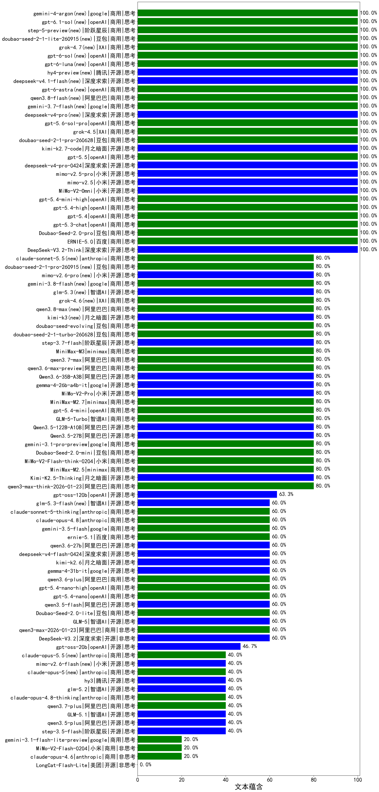

|类别|机构|大模型|【文本蕴含】准确率|平均耗时|平均消耗token|花费/千次（元）|排名（准确率）|
|---|---|-----|-------------------|-------|-----------|-----------|-----------|
|商用|豆包|doubao-seed-2-1-pro-260628|100.0%|578s|13477|402.0|1|
|开源|腾讯|hy4-preview(new)|100.0%|47s|1956|34.4|2|
|开源|月之暗面|kimi-k2.7-code|100.0%|11s|321|7.6|3|
|商用|XAI|grok-4.5|100.0%|112s|1535|57.1|4|
|商用|openAI|gpt-5.6-sol-pro|100.0%|11s|2558|163.3|5|
|开源|深度求索|deepseek-v4-pro|100.0%|25s|994|24.5|6|
|商用|google|gemini-3.7-flash|100.0%|4s|464|11.0|7|
|商用|阿里巴巴|qwen3.8-flash(new)|100.0%|20s|592|1.4|8|
|商用|openAI|gpt-5.5|100.0%|5s|271|44.2|9|
|开源|深度求索|deepseek-v4-pro-0424|100.0%|33s|1025|24.0|10|
|开源|小米|mimo-v2.5-pro|100.0%|23s|1402|25.2|11|
|开源|小米|mimo-v2.5|100.0%|25s|1646|19.7|12|
|开源|深度求索|deepseek-v4.1-flash(new)|100.0%|4s|763|5.6|13|
|商用|openAI|gpt-6-astra(new)|100.0%|15s|184|44.3|14|
|商用|google|gemini-4-argon(new)|100.0%|15s|257|26.3|15|
|商用|openAI|gpt-6-sol(new)|100.0%|120s|208|10.5|16|
|商用|XAI|grok-4.7(new)|100.0%|28s|3016|90.3|17|
|开源|深度求索|DeepSeek-V3.2-Think|100.0%|183s|1119|3.3|18|
|商用|百度|ERNIE-5.0|100.0%|110s|2165|51.1|19|
|商用|豆包|doubao-seed-2-1-lite-260915(new)|100.0%|81s|4050|10.8|20|
|商用|阶跃星辰|step-5-preview(new)|100.0%|16s|790|15.1|21|
|商用|openAI|gpt-6-luna(new)|100.0%|189s|266|0.7|22|
|商用|openAI|gpt-6.1-sol(new)|100.0%|6s|176|8.3|23|
|开源|小米|mimo-v2.6-pro(new)|80.0%|32s|1091|6.4|24|
|商用|阿里巴巴|qwen3.8-max|80.0%|59s|2365|82.9|25|
|开源|月之暗面|kimi-k3|80.0%|43s|1110|100.5|26|
|开源|智谱AI|glm-5.3(new)|80.0%|166s|5429|150.8|27|
|商用|anthropic|claude-sonnet-5.5(new)|80.0%|6s|327|17.4|28|
|商用|XAI|grok-4.6|80.0%|30s|1550|57.8|29|
|商用|豆包|doubao-seed-2-1-pro-260915(new)|80.0%|123s|4292|126.4|30|
|商用|google|gemini-3.8-flash(new)|80.0%|13s|779|38.5|31|
|商用|豆包|doubao-seed-2-1-turbo-260628|80.0%|265s|10255|152.7|32|
|商用|豆包|doubao-seed-evolving|80.0%|330s|12189|363.4|33|
|商用|minimax|MiniMax-M3.1-Flash(new)|80.0%|13s|668|1.9|34|
|商用|阿里巴巴|qwen3.6-max-preview|80.0%|47s|1456|76.1|35|
|商用|google|gemini-3.1-pro-preview|80.0%|25s|1143|93.3|36|
|开源|阶跃星辰|step-3.7-flash|80.0%|28s|2980|23.7|37|
|开源|阿里巴巴|Qwen3.5-27B|80.0%|370s|3483|16.5|38|
|开源|阿里巴巴|Qwen3.5-122B-A10B|80.0%|253s|3702|23.4|39|
|商用|minimax|MiniMax-M3|80.0%|28s|797|10.6|40|
|商用|minimax|MiniMax-M2.7|80.0%|38s|1428|11.4|41|
|商用|阿里巴巴|qwen3.7-max|80.0%|20s|879|30.3|42|
|开源|google|gemma-4-26b-a4b-it|80.0%|15s|468|1.2|43|
|开源|阿里巴巴|Qwen3.6-35B-A3B|80.0%|9s|1568|16.4|44|
|开源|openAI|gpt-oss-120b|63.3%|240s|450|1.1|45|
|商用|anthropic|claude-haiku-5.5(new)|60.0%|4s|576|1.7|46|
|开源|深度求索|DeepSeek-V3.2|60.0%|82s|435|1.3|47|
|商用|阿里巴巴|qwen3.6-plus|60.0%|29s|1512|17.6|48|
|开源|google|gemma-4-31b-it|60.0%|38s|364|0.9|49|
|开源|月之暗面|kimi-k2.6|60.0%|69s|1219|31.8|50|
|开源|智谱AI|glm-5.3-flash(new)|60.0%|94s|1513|4.1|51|
|商用|anthropic|claude-sonnet-5-thinking|60.0%|11s|545|32.8|52|
|开源|阿里巴巴|qwen3.6-27b|60.0%|27s|1584|27.6|53|
|商用|百度|ernie-5.1|60.0%|23s|915|15.6|54|
|商用|google|gemini-3.5-flash|60.0%|13s|1638|100.2|55|
|开源|深度求索|deepseek-v4-flash-0424|60.0%|28s|1111|2.2|56|
|商用|anthropic|claude-opus-4.8|60.0%|6s|387|54.2|57|
|开源|openAI|gpt-oss-20b|46.7%|238s|613|0.6|58|
|商用|阿里巴巴|qwen3.7-plus|40.0%|48s|2400|18.9|59|
|开源|腾讯|hy3|40.0%|148s|164|0.5|60|
|商用|anthropic|claude-opus-4.8-thinking|40.0%|11s|695|108.2|61|
|开源|智谱AI|glm-5.2|40.0%|34s|1092|29.4|62|
|商用|anthropic|claude-opus-5|40.0%|9s|537|80.4|63|
|开源|小米|mimo-v2.6-flash(new)|40.0%|45s|806|1.6|64|
|开源|智谱AI|GLM-5.1|40.0%|114s|1161|26.9|65|
|商用|anthropic|claude-opus-5.5(new)|40.0%|13s|518|61.5|66|
|商用|google|gemini-3.1-flash-lite-preview|20.0%|2s|282|2.5|67|

