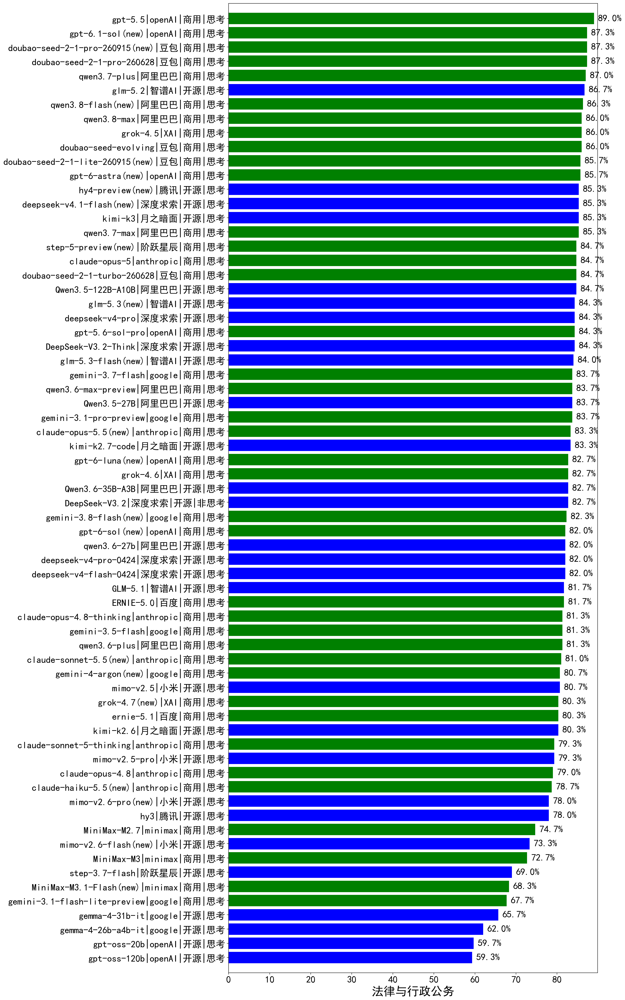

|类别|机构|大模型|【法律与行政公务】准确率|平均耗时|平均消耗token|花费/千次（元）|排名（准确率）|
|---|---|-----|-------------------|-------|-----------|-----------|-----------|
|商用|openAI|gpt-5.5|89.0%|17s|1114|205.2|1|
|商用|openAI|gpt-6.1-sol(new)|87.3%|36s|433|21.1|2|
|商用|豆包|doubao-seed-2-1-pro-260915(new)|87.3%|100s|3292|94.5|3|
|商用|豆包|doubao-seed-2-1-pro-260628|87.3%|267s|11201|331.8|4|
|商用|阿里巴巴|qwen3.7-plus|87.0%|50s|2729|21.1|5|
|开源|智谱AI|glm-5.2|86.7%|64s|2749|74.2|6|
|商用|阿里巴巴|qwen3.8-flash(new)|86.3%|57s|3137|8.1|7|
|商用|XAI|grok-4.5|86.0%|74s|3289|128.5|8|
|商用|阿里巴巴|qwen3.8-max|86.0%|78s|3184|110.6|9|
|商用|豆包|doubao-seed-evolving|86.0%|277s|11730|347.6|10|
|商用|豆包|doubao-seed-2-1-lite-260915(new)|85.7%|79s|3182|8.3|11|
|商用|openAI|gpt-6-astra(new)|85.7%|17s|495|127.4|12|
|商用|阿里巴巴|qwen3.7-max|85.3%|37s|1842|63.2|13|
|开源|月之暗面|kimi-k3|85.3%|103s|2438|223.0|14|
|开源|深度求索|deepseek-v4.1-flash(new)|85.3%|12s|1938|14.6|15|
|开源|腾讯|hy4-preview(new)|85.3%|105s|6463|114.6|16|
|开源|月之暗面|kimi-k3.1-pro(new)|85.0%|96s|3134|202.1|17|
|商用|anthropic|claude-opus-5|84.7%|15s|997|142.8|18|
|商用|阶跃星辰|step-5-preview(new)|84.7%|48s|3881|75.9|19|
|商用|豆包|doubao-seed-2-1-turbo-260628|84.7%|245s|9470|139.9|20|
|开源|阿里巴巴|Qwen3.5-122B-A10B|84.7%|238s|4438|27.7|21|
|商用|openAI|gpt-5.6-sol-pro|84.3%|35s|5341|488.6|22|
|开源|智谱AI|glm-5.3(new)|84.3%|160s|3844|104.9|23|
|开源|深度求索|deepseek-v4-pro|84.3%|128s|4109|107.3|24|
|开源|深度求索|DeepSeek-V3.2-Think|84.3%|137s|1957|5.7|25|
|开源|智谱AI|glm-5.3-flash(new)|84.0%|130s|4319|11.8|26|
|商用|google|gemini-3.1-pro-preview|83.7%|44s|2118|169.9|27|
|开源|阿里巴巴|Qwen3.5-27B|83.7%|356s|4390|20.5|28|
|商用|阿里巴巴|qwen3.6-max-preview|83.7%|88s|2583|133.7|29|
|商用|google|gemini-3.7-flash|83.7%|5s|988|22.8|30|
|商用|anthropic|claude-opus-5.5(new)|83.3%|24s|900|100.4|31|
|开源|月之暗面|kimi-k2.7-code|83.3%|71s|2285|59.2|32|
|商用|openAI|gpt-6-luna(new)|82.7%|276s|939|2.8|33|
|开源|深度求索|DeepSeek-V3.2|82.7%|67s|809|2.3|34|
|开源|阿里巴巴|Qwen3.6-35B-A3B|82.7%|49s|2803|29.1|35|
|商用|XAI|grok-4.6|82.7%|74s|2797|107.8|36|
|商用|google|gemini-3.8-flash(new)|82.3%|12s|1187|56.1|37|
|商用|openAI|gpt-6-sol(new)|82.0%|146s|451|22.4|38|
|开源|深度求索|deepseek-v4-flash-0424|82.0%|35s|1738|3.4|39|
|开源|深度求索|deepseek-v4-pro-0424|82.0%|51s|1474|33.9|40|
|开源|阿里巴巴|qwen3.6-27b|82.0%|43s|2741|47.4|41|
|开源|智谱AI|GLM-5.1|81.7%|187s|2306|53.0|42|
|商用|百度|ERNIE-5.0|81.7%|203s|2926|68.0|43|
|商用|anthropic|claude-opus-4.8-thinking|81.3%|18s|1408|214.7|44|
|商用|阿里巴巴|qwen3.6-plus|81.3%|61s|2606|30.0|45|
|商用|google|gemini-3.5-flash|81.3%|14s|2208|131.2|46|
|商用|anthropic|claude-sonnet-5.5(new)|81.0%|9s|860|47.4|47|
|开源|小米|mimo-v2.5|80.7%|25s|2197|26.5|48|
|商用|google|gemini-4-argon(new)|80.7%|16s|633|69.4|49|
|开源|月之暗面|kimi-k2.6|80.3%|166s|3241|84.0|50|
|商用|XAI|grok-4.7(new)|80.3%|83s|6397|230.0|51|
|商用|百度|ernie-5.1|80.3%|53s|2369|40.6|52|
|开源|小米|mimo-v2.5-pro|79.3%|49s|3068|59.1|53|
|商用|anthropic|claude-sonnet-5-thinking|79.3%|22s|1486|91.3|54|
|商用|anthropic|claude-opus-4.8|79.0%|10s|794|107.2|55|
|商用|anthropic|claude-haiku-5.5(new)|78.7%|9s|1397|4.2|56|
|开源|小米|mimo-v2.6-pro(new)|78.0%|77s|3787|22.3|57|
|开源|腾讯|hy3|78.0%|64s|446|1.4|58|
|商用|minimax|MiniMax-M2.7|74.7%|80s|3391|27.5|59|
|开源|小米|mimo-v2.6-flash(new)|73.3%|294s|2031|3.9|60|
|商用|minimax|MiniMax-M3|72.7%|77s|1804|26.6|61|
|开源|阶跃星辰|step-3.7-flash|69.0%|891s|4564|36.1|62|
|商用|minimax|MiniMax-M3.1-Flash(new)|68.3%|65s|3890|14.6|63|
|商用|google|gemini-3.1-flash-lite-preview|67.7%|7s|629|5.3|64|
|开源|google|gemma-4-31b-it|65.7%|113s|748|1.8|65|
|开源|google|gemma-4-26b-a4b-it|62.0%|48s|952|2.4|66|
|开源|openAI|gpt-oss-20b|59.7%|123s|2182|2.3|67|
|开源|openAI|gpt-oss-120b|59.3%|130s|1227|3.4|68|

