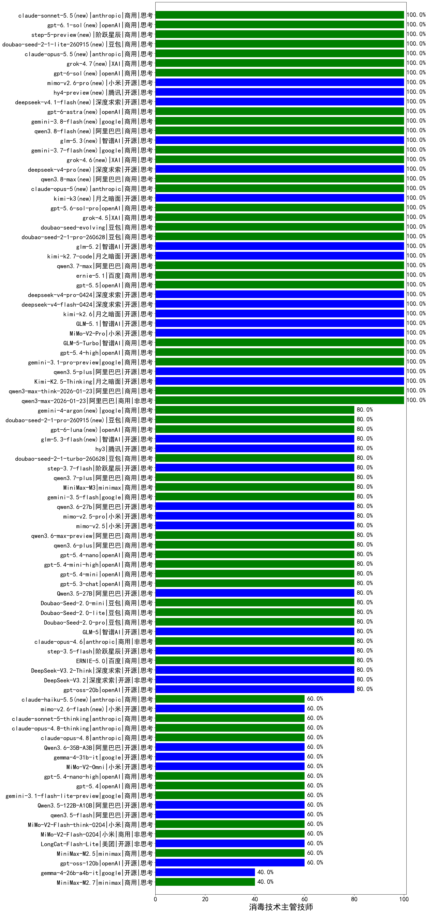

|类别|机构|大模型|【消毒技术主管技师】准确率|平均耗时|平均消耗token|花费/千次（元）|排名（准确率）|
|---|---|-----|-------------------|-------|-----------|-----------|-----------|
|开源|月之暗面|kimi-k3.1-pro(new)|100.0%|32s|1177|69.6|1|
|商用|XAI|grok-4.6|100.0%|1070s|1048|35.1|2|
|商用|openAI|gpt-6-astra(new)|100.0%|15s|306|68.3|3|
|商用|百度|ernie-5.1|100.0%|49s|720|11.3|4|
|商用|google|gemini-3.8-flash(new)|100.0%|20s|621|27.1|5|
|商用|阿里巴巴|qwen3.7-max|100.0%|16s|787|25.5|6|
|商用|阿里巴巴|qwen3.8-flash(new)|100.0%|40s|1025|2.4|7|
|开源|智谱AI|glm-5.3(new)|100.0%|27s|717|17.6|8|
|商用|google|gemini-3.7-flash|100.0%|5s|638|14.0|9|
|开源|月之暗面|kimi-k2.7-code|100.0%|50s|546|12.5|10|
|开源|月之暗面|kimi-k3|100.0%|26s|644|49.2|11|
|开源|智谱AI|glm-5.2|100.0%|80s|1215|31.6|12|
|商用|豆包|doubao-seed-2-1-pro-260628|100.0%|119s|3684|106.7|13|
|开源|深度求索|deepseek-v4-pro|100.0%|23s|597|12.7|14|
|商用|豆包|doubao-seed-evolving|100.0%|146s|4734|138.3|15|
|商用|阿里巴巴|qwen3.8-max|100.0%|18s|782|24.4|16|
|商用|anthropic|claude-opus-5|100.0%|15s|631|84.3|17|
|商用|XAI|grok-4.5|100.0%|54s|1010|33.5|18|
|商用|openAI|gpt-5.5|100.0%|7s|403|60.3|19|
|开源|深度求索|deepseek-v4-pro-0424|100.0%|21s|518|11.3|20|
|开源|深度求索|deepseek-v4-flash-0424|100.0%|34s|695|1.3|21|
|商用|XAI|grok-4.7(new)|100.0%|18s|2449|65.0|22|
|商用|anthropic|claude-sonnet-5.5(new)|100.0%|7s|584|30.3|23|
|商用|google|gemini-3.1-pro-preview|100.0%|50s|1037|79.1|24|
|商用|openAI|gpt-6.1-sol(new)|100.0%|5s|256|10.2|25|
|商用|阶跃星辰|step-5-preview(new)|100.0%|21s|1782|34.1|26|
|商用|豆包|doubao-seed-2-1-lite-260915(new)|100.0%|22s|961|2.3|27|
|开源|深度求索|deepseek-v4.1-flash(new)|100.0%|32s|577|3.8|28|
|商用|anthropic|claude-opus-5.5(new)|100.0%|12s|627|66.7|29|
|商用|openAI|gpt-6-sol(new)|100.0%|248s|278|11.7|30|
|开源|智谱AI|GLM-5.1|100.0%|147s|1220|27.2|31|
|开源|小米|mimo-v2.6-pro(new)|100.0%|13s|580|3.1|32|
|开源|月之暗面|kimi-k2.6|100.0%|92s|1126|28.1|33|
|开源|腾讯|hy4-preview(new)|100.0%|24s|1494|25.4|34|
|商用|openAI|gpt-5.6-sol-pro|100.0%|8s|2902|184.0|35|
|商用|豆包|doubao-seed-2-1-pro-260915(new)|80.0%|22s|726|18.0|36|
|开源|智谱AI|glm-5.3-flash(new)|80.0%|35s|1388|3.6|37|
|商用|openAI|gpt-6-luna(new)|80.0%|221s|353|0.8|38|
|商用|google|gemini-4-argon(new)|80.0%|19s|432|43.4|39|
|商用|minimax|MiniMax-M3.1-Flash(new)|80.0%|12s|807|2.3|40|
|商用|豆包|doubao-seed-2-1-turbo-260628|80.0%|228s|9304|137.7|41|
|开源|腾讯|hy3|80.0%|158s|228|0.6|42|
|商用|google|gemini-3.5-flash|80.0%|8s|1106|62.8|43|
|开源|阿里巴巴|Qwen3.5-27B|80.0%|108s|2652|12.2|44|
|商用|百度|ERNIE-5.0|80.0%|83s|1632|37.2|45|
|开源|深度求索|DeepSeek-V3.2-Think|80.0%|135s|1046|3.0|46|
|商用|阿里巴巴|qwen3.6-max-preview|80.0%|50s|1550|78.3|47|
|开源|小米|mimo-v2.5|80.0%|14s|1008|10.0|48|
|开源|小米|mimo-v2.5-pro|80.0%|16s|901|13.8|49|
|开源|阿里巴巴|qwen3.6-27b|80.0%|29s|1793|30.5|50|
|商用|minimax|MiniMax-M3|80.0%|17s|599|6.5|51|
|商用|阿里巴巴|qwen3.7-plus|80.0%|19s|1033|7.5|52|
|开源|阶跃星辰|step-3.7-flash|80.0%|18s|1120|8.3|53|
|开源|深度求索|DeepSeek-V3.2|80.0%|95s|316|0.8|54|
|开源|openAI|gpt-oss-20b|80.0%|7s|1043|1.0|55|
|商用|阿里巴巴|qwen3.6-plus|80.0%|20s|1541|17.3|56|
|商用|google|gemini-3.1-flash-lite-preview|60.0%|4s|308|2.1|57|
|商用|anthropic|claude-haiku-5.5(new)|60.0%|7s|587|1.5|58|
|开源|阿里巴巴|Qwen3.5-122B-A10B|60.0%|292s|2304|14.1|59|
|开源|小米|mimo-v2.6-flash(new)|60.0%|614s|775|1.4|60|
|开源|google|gemma-4-31b-it|60.0%|31s|372|0.8|61|
|开源|阿里巴巴|Qwen3.6-35B-A3B|60.0%|101s|1579|16.0|62|
|商用|anthropic|claude-sonnet-5-thinking|60.0%|9s|519|25.9|63|
|商用|anthropic|claude-opus-4.8|60.0%|7s|480|57.9|64|
|商用|anthropic|claude-opus-4.8-thinking|60.0%|7s|572|74.1|65|
|开源|openAI|gpt-oss-120b|60.0%|4s|653|1.6|66|
|商用|minimax|MiniMax-M2.7|40.0%|44s|1582|12.4|67|
|开源|google|gemma-4-26b-a4b-it|40.0%|75s|492|1.1|68|

