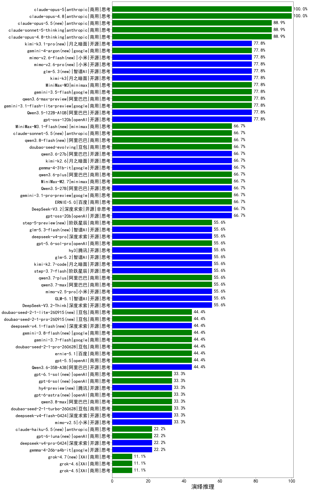

|类别|机构|大模型|【演绎推理】准确率|平均耗时|平均消耗token|花费/千次（元）|排名（准确率）|
|---|---|-----|-------------------|-------|-----------|-----------|-----------|
|商用|anthropic|claude-opus-5(new)|100.0%|7s|478|66.8|1|
|商用|anthropic|claude-opus-4.8|100.0%|9s|455|62.8|2|
|商用|anthropic|claude-opus-4.6|100.0%|14s|411|54.7|3|
|商用|anthropic|claude-sonnet-5-thinking|88.9%|10s|603|35.5|4|
|商用|anthropic|claude-opus-5.5(new)|88.9%|22s|718|86.7|5|
|开源|阿里巴巴|qwen3.5-plus|88.9%|48s|3655|17.2|6|
|商用|anthropic|claude-opus-4.8-thinking|88.9%|14s|920|144.2|7|
|商用|minimax|MiniMax-M3|77.8%|27s|810|10.6|8|
|商用|google|gemini-3.1-flash-lite-preview|77.8%|4s|241|1.9|9|
|商用|阿里巴巴|qwen3.6-max-preview|77.8%|43s|1376|70.7|10|
|商用|google|gemini-3.5-flash|77.8%|7s|1207|72.0|11|
|开源|openAI|gpt-oss-120b|77.8%|41s|498|1.3|12|
|开源|月之暗面|kimi-k3(new)|77.8%|38s|830|71.3|13|
|开源|智谱AI|glm-5.3(new)|77.8%|82s|2905|79.8|14|
|开源|小米|mimo-v2.6-pro(new)|77.8%|20s|907|5.2|15|
|开源|小米|mimo-v2.6-flash(new)|77.8%|18s|684|1.3|16|
|开源|阿里巴巴|Qwen3.5-122B-A10B|77.8%|223s|4158|26.2|17|
|商用|google|gemini-4-argon(new)|77.8%|21s|315|32.1|18|
|商用|豆包|Doubao-Seed-2.0-lite|77.8%|173s|825|2.6|19|
|商用|豆包|Doubao-Seed-2.0-mini|66.7%|178s|1239|2.3|20|
|商用|openAI|gpt-5.4-nano-high|66.7%|9s|347|2.4|21|
|开源|美团|LongCat-Flash-Lite|66.7%|210s|511|0.0|22|
|开源|阿里巴巴|qwen3.6-27b|66.7%|25s|1632|28.2|23|
|开源|openAI|gpt-oss-20b|66.7%|105s|490|0.5|24|
|商用|google|gemini-3.1-pro-preview|66.7%|30s|1178|94.8|25|
|开源|月之暗面|kimi-k2.6|66.7%|117s|1620|42.3|26|
|商用|豆包|doubao-seed-evolving|66.7%|219s|7601|225.3|27|
|开源|google|gemma-4-31b-it|66.7%|15s|327|0.8|28|
|商用|阿里巴巴|qwen3.6-plus|66.7%|36s|1525|17.5|29|
|商用|阿里巴巴|qwen3-max-2026-01-23|66.7%|72s|510|4.5|30|
|商用|minimax|MiniMax-M2.7|66.7%|20s|786|6.0|31|
|商用|小米|MiMo-V2-Flash-0204|66.7%|45s|404|0.7|32|
|商用|阿里巴巴|qwen3.8-flash(new)|66.7%|58s|3144|8.2|33|
|商用|openAI|gpt-5.4-mini-high|66.7%|16s|307|7.5|34|
|开源|阿里巴巴|qwen3.5-flash|66.7%|206s|3494|6.8|35|
|开源|阿里巴巴|Qwen3.5-27B|66.7%|328s|4036|19.0|36|
|商用|anthropic|claude-sonnet-5.5(new)|66.7%|38s|663|39.5|37|
|开源|深度求索|DeepSeek-V3.2|66.7%|79s|331|0.9|38|
|商用|百度|ERNIE-5.0|66.7%|89s|1124|25.8|39|
|商用|openAI|gpt-5.6-sol-pro|55.6%|12s|2768|192.5|40|
|开源|腾讯|hy3|55.6%|58s|225|0.7|41|
|开源|深度求索|DeepSeek-V3.2-Think|55.6%|42s|897|2.6|42|
|商用|阿里巴巴|qwen3-max-think-2026-01-23|55.6%|63s|1819|17.6|43|
|开源|智谱AI|glm-5.2|55.6%|25s|1140|30.4|44|
|开源|月之暗面|kimi-k2.7-code|55.6%|13s|439|10.5|45|
|商用|阶跃星辰|step-5-preview(new)|55.6%|38s|1113|21.3|46|
|商用|阿里巴巴|qwen3.7-plus|55.6%|27s|1258|9.6|47|
|开源|智谱AI|glm-5.3-flash(new)|55.6%|96s|2840|7.8|48|
|商用|阿里巴巴|qwen3.7-max|55.6%|20s|1002|34.2|49|
|开源|深度求索|deepseek-v4-pro(new)|55.6%|56s|2467|63.9|50|
|开源|阶跃星辰|step-3.7-flash|55.6%|52s|4228|33.7|51|
|商用|豆包|Doubao-Seed-2.0-pro|55.6%|371s|1691|25.6|52|
|开源|小米|mimo-v2.5-pro|55.6%|23s|1301|22.9|53|
|商用|openAI|gpt-5.4|55.6%|5s|230|17.0|54|
|商用|openAI|gpt-5.4-nano|55.6%|44s|231|1.4|55|
|开源|智谱AI|GLM-5.1|55.6%|22s|903|20.4|56|
|开源|小米|MiMo-V2-Pro|55.6%|44s|1247|21.8|57|
|商用|百度|ernie-5.1|44.4%|19s|695|11.5|58|
|开源|小米|MiMo-V2-Omni|44.4%|81s|1345|15.3|59|
|商用|openAI|gpt-5.3-chat|44.4%|6s|379|30.2|60|
|商用|豆包|doubao-seed-2-1-lite-260915(new)|44.4%|40s|1751|4.5|61|
|商用|豆包|doubao-seed-2-1-pro-260915(new)|44.4%|74s|2568|74.3|62|
|商用|openAI|gpt-5.4-high|44.4%|9s|438|38.9|63|
|开源|深度求索|deepseek-v4.1-flash(new)|44.4%|5s|999|7.4|64|
|商用|google|gemini-3.8-flash(new)|44.4%|17s|708|33.9|65|
|商用|openAI|gpt-5.4-mini|44.4%|9s|201|4.2|66|
|商用|minimax|MiniMax-M2.5|44.4%|21s|1148|9.0|67|
|商用|google|gemini-3.7-flash(new)|44.4%|43s|713|17.1|68|
|商用|openAI|gpt-5.5|44.4%|16s|484|87.5|69|
|开源|月之暗面|Kimi-K2.5-Thinking|44.4%|319s|1557|31.5|70|
|开源|阿里巴巴|Qwen3.6-35B-A3B|44.4%|11s|1463|15.1|71|
|商用|小米|MiMo-V2-Flash-think-0204|44.4%|1090s|2104|4.3|72|
|商用|豆包|doubao-seed-2-1-pro-260628|44.4%|349s|8432|250.2|73|
|商用|阿里巴巴|qwen3.8-max(new)|33.3%|61s|2339|81.4|74|
|商用|openAI|gpt-6-sol(new)|33.3%|140s|239|12.2|75|
|商用|openAI|gpt-6.1-sol(new)|33.3%|38s|178|7.9|76|
|开源|深度求索|deepseek-v4-flash-0424|33.3%|36s|724|1.4|77|
|开源|智谱AI|GLM-5|33.3%|82s|2740|48.3|78|
|开源|小米|mimo-v2.5|33.3%|16s|1310|14.8|79|
|商用|豆包|doubao-seed-2-1-turbo-260628|33.3%|224s|9521|141.4|80|
|开源|腾讯|hy4-preview(new)|33.3%|63s|4042|71.7|81|
|商用|openAI|gpt-6-astra(new)|33.3%|10s|195|45.5|82|
|商用|openAI|gpt-6-luna(new)|22.2%|60s|319|0.9|83|
|商用|智谱AI|GLM-5-Turbo|22.2%|26s|921|19.1|84|
|开源|阶跃星辰|step-3.5-flash|22.2%|30s|1610|3.3|85|
|开源|google|gemma-4-26b-a4b-it|22.2%|30s|565|1.4|86|
|开源|深度求索|deepseek-v4-pro-0424|22.2%|43s|789|18.1|87|
|商用|XAI|grok-4.6(new)|11.1%|45s|1133|39.9|88|
|商用|XAI|grok-4.7(new)|11.1%|47s|2610|72.9|89|
|商用|XAI|grok-4.5|11.1%|52s|1338|48.5|90|

