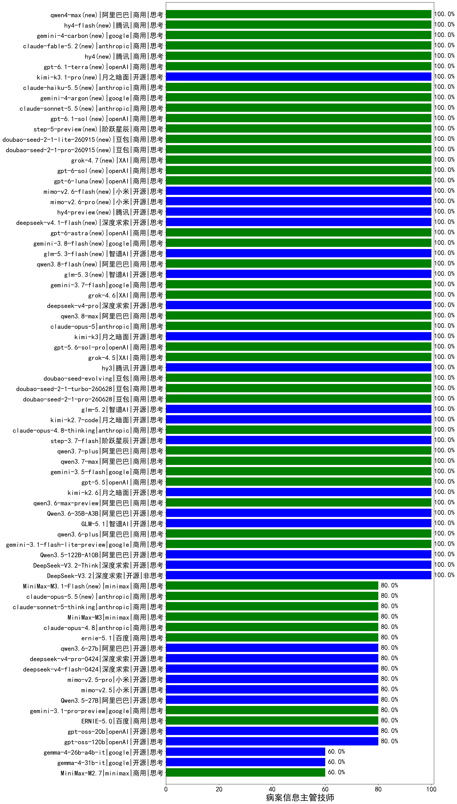

|类别|机构|大模型|【病案信息主管技师】准确率|平均耗时|平均消耗token|花费/千次（元）|排名（准确率）|
|---|---|-----|-------------------|-------|-----------|-----------|-----------|
|商用|google|gemini-4-carbon(new)|100.0%|19s|1018|132.5|1|
|商用|anthropic|claude-opus-5|100.0%|13s|734|115.5|2|
|商用|anthropic|claude-opus-4.8-thinking|100.0%|24s|891|142.9|3|
|开源|月之暗面|kimi-k2.7-code|100.0%|19s|682|17.2|4|
|开源|智谱AI|glm-5.2|100.0%|88s|2941|81.0|5|
|商用|豆包|doubao-seed-2-1-pro-260628|100.0%|177s|5458|161.3|6|
|商用|豆包|doubao-seed-2-1-turbo-260628|100.0%|159s|7893|117.2|7|
|商用|豆包|doubao-seed-evolving|100.0%|130s|5789|171.3|8|
|商用|openAI|gpt-6-sol(new)|100.0%|172s|234|12.1|9|
|开源|腾讯|hy3|100.0%|30s|166|0.5|10|
|商用|XAI|grok-4.5|100.0%|36s|1661|62.4|11|
|商用|openAI|gpt-5.6-sol-pro|100.0%|14s|3211|245.0|12|
|开源|月之暗面|kimi-k3|100.0%|44s|901|79.3|13|
|商用|阿里巴巴|qwen3.8-max|100.0%|16s|628|20.2|14|
|商用|阿里巴巴|qwen3.7-plus|100.0%|20s|934|7.1|15|
|开源|深度求索|deepseek-v4-pro|100.0%|382s|471|10.3|16|
|商用|XAI|grok-4.6|100.0%|355s|1623|60.8|17|
|商用|google|gemini-3.7-flash|100.0%|5s|708|17.3|18|
|开源|智谱AI|glm-5.3(new)|100.0%|157s|1252|33.8|19|
|商用|阿里巴巴|qwen3.8-flash(new)|100.0%|50s|2437|6.4|20|
|开源|智谱AI|glm-5.3-flash(new)|100.0%|29s|1024|2.7|21|
|商用|google|gemini-3.8-flash(new)|100.0%|43s|965|48.0|22|
|商用|openAI|gpt-6-astra(new)|100.0%|11s|282|77.1|23|
|开源|深度求索|deepseek-v4.1-flash(new)|100.0%|9s|619|4.5|24|
|开源|腾讯|hy4-preview(new)|100.0%|84s|4996|89.1|25|
|开源|小米|mimo-v2.6-pro(new)|100.0%|20s|665|3.8|26|
|开源|阶跃星辰|step-3.7-flash|100.0%|17s|2127|16.8|27|
|商用|XAI|grok-4.7(new)|100.0%|34s|3205|98.2|28|
|商用|openAI|gpt-6-luna(new)|100.0%|458s|752|2.4|29|
|开源|智谱AI|GLM-5.1|100.0%|196s|1627|38.0|30|
|开源|深度求索|DeepSeek-V3.2|100.0%|17s|281|0.8|31|
|开源|深度求索|DeepSeek-V3.2-Think|100.0%|26s|792|2.3|32|
|商用|anthropic|claude-fable-5.2(new)|100.0%|55s|606|148.4|33|
|商用|腾讯|hy4(new)|100.0%|92s|4592|81.8|34|
|商用|openAI|gpt-6.1-terra(new)|100.0%|5s|250|6.6|35|
|开源|阿里巴巴|Qwen3.5-122B-A10B|100.0%|396s|3771|23.8|36|
|商用|google|gemini-3.1-flash-lite-preview|100.0%|3s|376|3.4|37|
|开源|月之暗面|kimi-k3.1-pro(new)|100.0%|29s|1076|65.7|38|
|商用|阿里巴巴|qwen3.6-plus|100.0%|45s|1548|18.0|39|
|商用|anthropic|claude-haiku-5.5(new)|100.0%|438s|624|1.9|40|
|开源|阿里巴巴|Qwen3.6-35B-A3B|100.0%|98s|1496|15.6|41|
|商用|阿里巴巴|qwen3.6-max-preview|100.0%|42s|1470|76.6|42|
|开源|月之暗面|kimi-k2.6|100.0%|47s|1142|29.6|43|
|商用|google|gemini-4-argon(new)|100.0%|20s|325|35.4|44|
|商用|anthropic|claude-sonnet-5.5(new)|100.0%|44s|537|32.3|45|
|商用|openAI|gpt-6.1-sol(new)|100.0%|34s|245|12.8|46|
|商用|阶跃星辰|step-5-preview(new)|100.0%|34s|1987|38.9|47|
|商用|openAI|gpt-5.5|100.0%|8s|372|64.7|48|
|商用|豆包|doubao-seed-2-1-lite-260915(new)|100.0%|23s|1275|3.3|49|
|商用|豆包|doubao-seed-2-1-pro-260915(new)|100.0%|67s|1364|38.5|50|
|商用|google|gemini-3.5-flash|100.0%|8s|1458|88.6|51|
|商用|阿里巴巴|qwen3.7-max|100.0%|30s|1518|53.1|52|
|开源|小米|mimo-v2.6-flash(new)|100.0%|249s|935|1.8|53|
|商用|anthropic|claude-opus-5.5(new)|80.0%|95s|611|74.9|54|
|商用|minimax|MiniMax-M3.1-Flash(new)|80.0%|31s|1984|7.2|55|
|开源|openAI|gpt-oss-120b|80.0%|7s|585|1.6|56|
|开源|openAI|gpt-oss-20b|80.0%|4s|804|0.8|57|
|商用|minimax|MiniMax-M3|80.0%|29s|746|9.7|58|
|商用|anthropic|claude-opus-4.8|80.0%|7s|464|68.2|59|
|商用|百度|ernie-5.1|80.0%|20s|769|13.0|60|
|开源|阿里巴巴|qwen3.6-27b|80.0%|30s|1891|33.1|61|
|开源|深度求索|deepseek-v4-pro-0424|80.0%|34s|1032|24.1|62|
|开源|深度求索|deepseek-v4-flash-0424|80.0%|19s|654|1.3|63|
|开源|小米|mimo-v2.5-pro|80.0%|19s|1138|19.6|64|
|开源|小米|mimo-v2.5|80.0%|36s|2077|25.7|65|
|开源|阿里巴巴|Qwen3.5-27B|80.0%|331s|2672|12.6|66|
|商用|google|gemini-3.1-pro-preview|80.0%|41s|2651|221.4|67|
|商用|百度|ERNIE-5.0|80.0%|92s|1799|42.2|68|
|商用|anthropic|claude-sonnet-5-thinking|80.0%|12s|864|55.3|69|
|开源|google|gemma-4-26b-a4b-it|60.0%|22s|530|1.3|70|
|开源|google|gemma-4-31b-it|60.0%|63s|521|1.3|71|
|商用|minimax|MiniMax-M2.7|60.0%|27s|1044|8.2|72|

