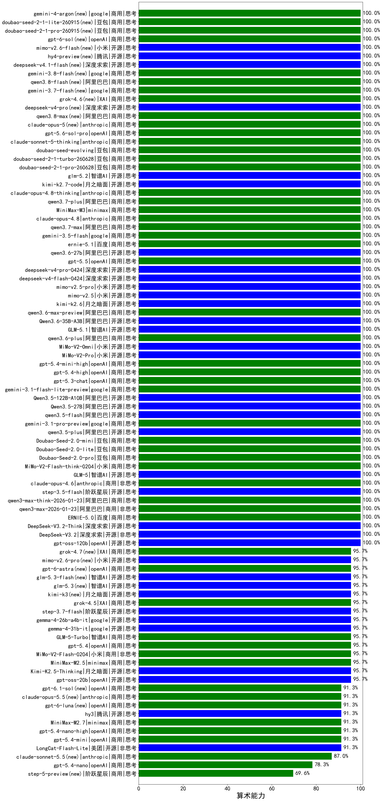

|类别|机构|大模型|【算术能力】准确率|平均耗时|平均消耗token|花费/千次（元）|排名（准确率）|
|---|---|-----|-------------------|-------|-----------|-----------|-----------|
|开源|openAI|gpt-oss-120b|100.0%|14s|379|1.1|1|
|开源|深度求索|deepseek-v4-pro|100.0%|559s|790|19.4|2|
|商用|阿里巴巴|qwen3.7-plus|100.0%|15s|717|5.5|3|
|商用|anthropic|claude-opus-4.8-thinking|100.0%|5s|274|42.2|4|
|开源|月之暗面|kimi-k2.7-code|100.0%|10s|360|9.0|5|
|开源|智谱AI|glm-5.2|100.0%|57s|1038|28.3|6|
|商用|豆包|doubao-seed-2-1-pro-260628|100.0%|134s|3011|88.5|7|
|商用|豆包|doubao-seed-evolving|100.0%|86s|3076|90.5|8|
|商用|anthropic|claude-sonnet-5-thinking|100.0%|10s|331|20.8|9|
|商用|openAI|gpt-5.6-sol-pro|100.0%|6s|2005|109.9|10|
|商用|anthropic|claude-opus-5|100.0%|6s|330|51.9|11|
|商用|阿里巴巴|qwen3.8-max|100.0%|14s|349|10.7|12|
|商用|XAI|grok-4.6|100.0%|38s|942|33.1|13|
|商用|anthropic|claude-opus-4.8|100.0%|4s|185|26.6|14|
|商用|google|gemini-3.7-flash|100.0%|4s|620|15.6|15|
|商用|阿里巴巴|qwen3.8-flash(new)|100.0%|36s|360|0.8|16|
|商用|google|gemini-3.8-flash(new)|100.0%|17s|531|26.6|17|
|开源|深度求索|deepseek-v4.1-flash(new)|100.0%|4s|297|2.0|18|
|开源|腾讯|hy4-preview(new)|100.0%|11s|750|12.9|19|
|开源|小米|mimo-v2.6-flash(new)|100.0%|105s|547|1.1|20|
|商用|openAI|gpt-6-sol(new)|100.0%|343s|95|4.8|21|
|商用|豆包|doubao-seed-2-1-pro-260915(new)|100.0%|18s|761|21.0|22|
|商用|豆包|doubao-seed-2-1-lite-260915(new)|100.0%|5s|327|0.8|23|
|商用|google|gemini-4-argon(new)|100.0%|10s|177|18.1|24|
|商用|minimax|MiniMax-M3|100.0%|16s|636|8.2|25|
|商用|豆包|doubao-seed-2-1-turbo-260628|100.0%|41s|1824|26.5|26|
|商用|阿里巴巴|qwen3.7-max|100.0%|31s|643|22.2|27|
|开源|月之暗面|kimi-k2.6|100.0%|132s|1501|39.9|28|
|开源|深度求索|DeepSeek-V3.2|100.0%|135s|236|0.7|29|
|开源|深度求索|DeepSeek-V3.2-Think|100.0%|26s|807|2.4|30|
|商用|百度|ERNIE-5.0|100.0%|371s|4152|99.1|31|
|商用|google|gemini-3.1-pro-preview|100.0%|36s|1025|85.2|32|
|开源|阿里巴巴|Qwen3.5-27B|100.0%|179s|4005|19.1|33|
|开源|阿里巴巴|Qwen3.5-122B-A10B|100.0%|165s|3547|22.5|34|
|商用|google|gemini-3.1-flash-lite-preview|100.0%|15s|104|0.8|35|
|商用|google|gemini-3.5-flash|100.0%|7s|1114|68.6|36|
|开源|智谱AI|GLM-5.1|100.0%|69s|1436|33.9|37|
|开源|阿里巴巴|Qwen3.6-35B-A3B|100.0%|153s|2112|22.4|38|
|商用|阿里巴巴|qwen3.6-max-preview|100.0%|36s|1168|61.3|39|
|商用|阿里巴巴|qwen3.6-plus|100.0%|33s|1471|17.3|40|
|开源|深度求索|deepseek-v4-pro-0424|100.0%|27s|474|11.0|41|
|开源|深度求索|deepseek-v4-flash-0424|100.0%|29s|533|1.0|42|
|开源|小米|mimo-v2.5|100.0%|25s|1879|23.2|43|
|商用|百度|ernie-5.1|100.0%|20s|671|11.7|44|
|开源|阿里巴巴|qwen3.6-27b|100.0%|43s|2656|47.2|45|
|开源|小米|mimo-v2.5-pro|100.0%|17s|739|11.6|46|
|商用|openAI|gpt-5.5|100.0%|25s|132|22.0|47|
|商用|minimax|MiniMax-M3.1-Flash(new)|95.7%|7s|395|0.9|48|
|开源|阶跃星辰|step-3.7-flash|95.7%|7s|608|4.7|49|
|商用|XAI|grok-4.7(new)|95.7%|19s|2407|65.6|50|
|商用|XAI|grok-4.5|95.7%|74s|973|34.4|51|
|开源|小米|mimo-v2.6-pro(new)|95.7%|23s|993|5.8|52|
|开源|月之暗面|kimi-k3|95.7%|23s|412|32.4|53|
|开源|openAI|gpt-oss-20b|95.7%|74s|871|1.0|54|
|商用|openAI|gpt-6-astra(new)|95.7%|12s|89|22.1|55|
|开源|智谱AI|glm-5.3-flash(new)|95.7%|27s|481|1.3|56|
|开源|智谱AI|glm-5.3(new)|95.7%|22s|564|15.0|57|
|开源|google|gemma-4-31b-it|95.7%|13s|138|0.3|58|
|开源|google|gemma-4-26b-a4b-it|95.7%|6s|164|0.4|59|
|开源|月之暗面|kimi-k3.1-pro(new)|95.7%|13s|524|29.6|60|
|商用|openAI|gpt-6-luna(new)|91.3%|79s|133|0.4|61|
|商用|minimax|MiniMax-M2.7|91.3%|92s|5231|43.5|62|
|商用|anthropic|claude-opus-5.5(new)|91.3%|12s|203|23.5|63|
|商用|openAI|gpt-6.1-sol(new)|91.3%|85s|89|4.4|64|
|商用|anthropic|claude-haiku-5.5(new)|91.3%|10s|232|0.7|65|
|开源|腾讯|hy3|91.3%|34s|152|0.5|66|
|商用|anthropic|claude-sonnet-5.5(new)|87.0%|4s|178|10.0|67|
|商用|阶跃星辰|step-5-preview(new)|69.6%|4s|251|4.6|68|

