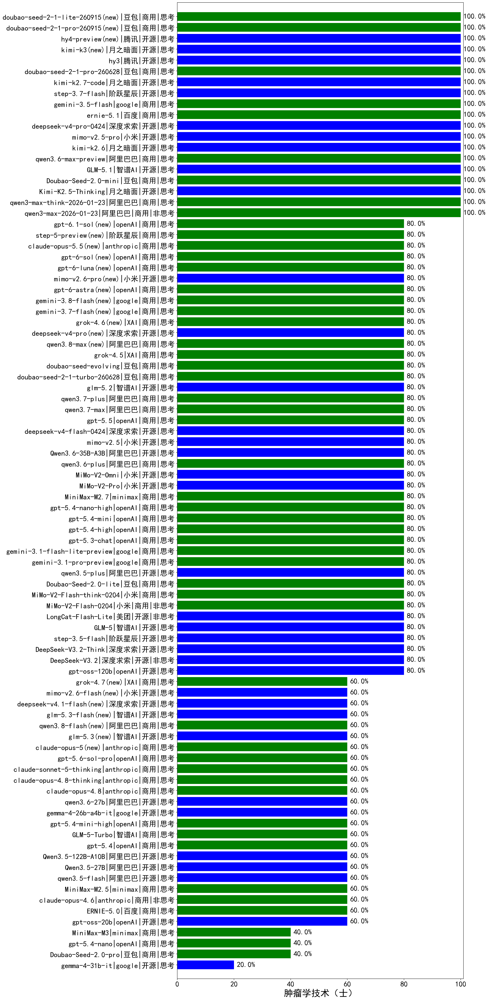

|类别|机构|大模型|【肿瘤学技术（士）】准确率|平均耗时|平均消耗token|花费/千次（元）|排名（准确率）|
|---|---|-----|-------------------|-------|-----------|-----------|-----------|
|商用|豆包|doubao-seed-2-1-pro-260628|100.0%|229s|7938|235.6|1|
|开源|腾讯|hy4-preview(new)|100.0%|93s|3516|62.4|2|
|开源|阶跃星辰|step-3.7-flash|100.0%|15s|2055|16.2|3|
|开源|腾讯|hy3|100.0%|102s|211|0.6|4|
|开源|月之暗面|kimi-k3|100.0%|33s|763|64.9|5|
|商用|google|gemini-3.5-flash|100.0%|12s|1399|84.7|6|
|商用|百度|ernie-5.1|100.0%|22s|774|13.1|7|
|开源|深度求索|deepseek-v4-pro-0424|100.0%|45s|1330|31.2|8|
|开源|小米|mimo-v2.5-pro|100.0%|21s|1230|21.5|9|
|商用|阿里巴巴|qwen3.6-max-preview|100.0%|51s|1436|74.5|10|
|开源|智谱AI|GLM-5.1|100.0%|265s|2059|48.3|11|
|开源|月之暗面|kimi-k2.6|100.0%|128s|1985|52.3|12|
|开源|月之暗面|kimi-k2.7-code|100.0%|46s|1591|41.6|13|
|商用|豆包|doubao-seed-2-1-lite-260915(new)|100.0%|40s|1612|4.2|14|
|商用|豆包|doubao-seed-2-1-pro-260915(new)|100.0%|106s|1360|38.3|15|
|开源|小米|mimo-v2.6-pro(new)|80.0%|29s|957|5.5|16|
|商用|豆包|doubao-seed-2-1-turbo-260628|80.0%|224s|12988|193.6|17|
|商用|anthropic|claude-sonnet-5.5(new)|80.0%|8s|534|32.4|18|
|商用|豆包|doubao-seed-evolving|80.0%|174s|7000|207.5|19|
|商用|openAI|gpt-6.1-sol(new)|80.0%|7s|232|12.0|20|
|商用|XAI|grok-4.5|80.0%|69s|1369|50.0|21|
|商用|阶跃星辰|step-5-preview(new)|80.0%|123s|4852|96.1|22|
|商用|openAI|gpt-6-astra(new)|80.0%|10s|234|60.6|23|
|开源|深度求索|deepseek-v4-pro|80.0%|356s|647|14.9|24|
|商用|anthropic|claude-opus-5.5(new)|80.0%|116s|611|75.6|25|
|商用|XAI|grok-4.6|80.0%|23s|1122|39.7|26|
|商用|openAI|gpt-6-sol(new)|80.0%|80s|276|15.0|27|
|商用|google|gemini-3.7-flash|80.0%|7s|829|20.4|28|
|开源|智谱AI|glm-5.2|80.0%|51s|2281|62.4|29|
|商用|openAI|gpt-6-luna(new)|80.0%|122s|573|1.8|30|
|商用|google|gemini-3.8-flash(new)|80.0%|18s|929|46.1|31|
|商用|阿里巴巴|qwen3.8-max|80.0%|37s|1565|53.8|32|
|开源|openAI|gpt-oss-120b|80.0%|36s|440|1.1|33|
|商用|阿里巴巴|qwen3.7-plus|80.0%|23s|1002|7.6|34|
|商用|minimax|MiniMax-M2.7|80.0%|42s|1556|12.5|35|
|开源|深度求索|DeepSeek-V3.2|80.0%|112s|345|1.0|36|
|开源|深度求索|DeepSeek-V3.2-Think|80.0%|197s|1665|4.9|37|
|开源|阿里巴巴|Qwen3.6-35B-A3B|80.0%|117s|1713|17.9|38|
|商用|阿里巴巴|qwen3.7-max|80.0%|24s|1124|38.8|39|
|商用|google|gemini-3.1-pro-preview|80.0%|24s|1426|116.9|40|
|商用|阿里巴巴|qwen3.6-plus|80.0%|42s|1384|15.9|41|
|商用|openAI|gpt-5.5|80.0%|7s|370|64.4|42|
|开源|深度求索|deepseek-v4-flash-0424|80.0%|60s|1033|2.0|43|
|开源|小米|mimo-v2.5|80.0%|12s|1181|13.1|44|
|商用|google|gemini-3.1-flash-lite-preview|80.0%|31s|300|2.6|45|
|开源|openAI|gpt-oss-20b|60.0%|13s|1116|1.2|46|
|商用|XAI|grok-4.7(new)|60.0%|80s|6372|231.1|47|
|开源|阿里巴巴|Qwen3.5-27B|60.0%|168s|3104|14.6|48|
|开源|阿里巴巴|Qwen3.5-122B-A10B|60.0%|337s|2865|18.0|49|
|商用|百度|ERNIE-5.0|60.0%|187s|2480|58.5|50|
|商用|anthropic|claude-haiku-5.5(new)|60.0%|10s|608|1.9|51|
|开源|小米|mimo-v2.6-flash(new)|60.0%|250s|737|1.4|52|
|开源|google|gemma-4-26b-a4b-it|60.0%|20s|489|1.2|53|
|开源|深度求索|deepseek-v4.1-flash(new)|60.0%|40s|930|6.9|54|
|商用|anthropic|claude-opus-4.8-thinking|60.0%|22s|425|62.3|55|
|开源|智谱AI|glm-5.3-flash(new)|60.0%|97s|3001|8.3|56|
|商用|阿里巴巴|qwen3.8-flash(new)|60.0%|72s|3146|8.3|57|
|开源|智谱AI|glm-5.3(new)|60.0%|267s|8666|241.2|58|
|开源|阿里巴巴|qwen3.6-27b|60.0%|26s|1545|26.8|59|
|商用|anthropic|claude-opus-5|60.0%|12s|606|93.8|60|
|商用|openAI|gpt-5.6-sol-pro|60.0%|15s|3092|235.6|61|
|商用|anthropic|claude-opus-4.8|60.0%|10s|358|50.5|62|
|商用|anthropic|claude-sonnet-5-thinking|60.0%|13s|583|36.0|63|
|商用|minimax|MiniMax-M3.1-Flash(new)|60.0%|22s|1218|4.1|64|
|商用|minimax|MiniMax-M3|40.0%|26s|656|8.1|65|
|商用|google|gemini-4-argon(new)|40.0%|9s|330|35.9|66|
|开源|google|gemma-4-31b-it|20.0%|82s|465|1.2|67|

