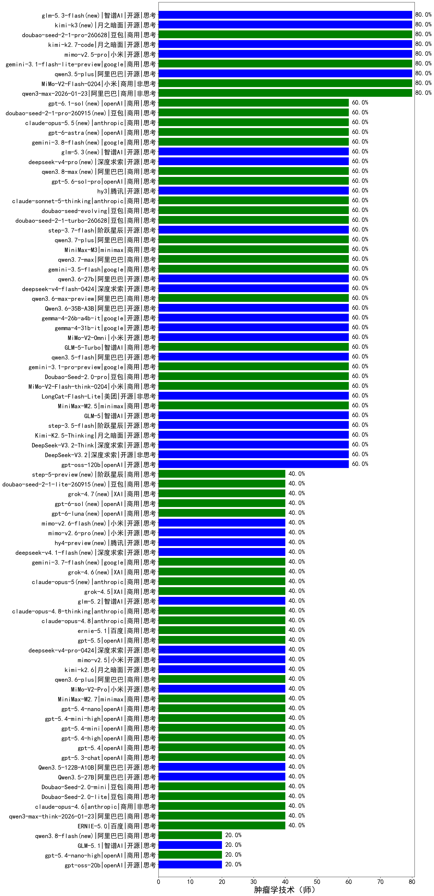

|类别|机构|大模型|【肿瘤学技术（师）】准确率|平均耗时|平均消耗token|花费/千次（元）|排名（准确率）|
|---|---|-----|-------------------|-------|-----------|-----------|-----------|
|商用|豆包|doubao-seed-2-1-pro-260628|80.0%|316s|11842|351.8|1|
|商用|anthropic|claude-haiku-5.5(new)|80.0%|11s|1236|3.9|2|
|开源|月之暗面|kimi-k2.7-code|80.0%|43s|1876|48.5|3|
|商用|google|gemini-3.1-flash-lite-preview|80.0%|13s|464|3.9|4|
|开源|小米|mimo-v2.5-pro|80.0%|30s|1925|35.4|5|
|开源|智谱AI|glm-5.3-flash(new)|80.0%|418s|2738|7.4|6|
|开源|月之暗面|kimi-k3|80.0%|56s|1238|109.1|7|
|商用|阿里巴巴|qwen3.8-max|60.0%|48s|1980|67.7|8|
|开源|阶跃星辰|step-3.7-flash|60.0%|65s|5914|47.1|9|
|商用|豆包|doubao-seed-2-1-turbo-260628|60.0%|319s|14287|212.6|10|
|商用|豆包|doubao-seed-evolving|60.0%|244s|11786|351.0|11|
|商用|anthropic|claude-sonnet-5-thinking|60.0%|22s|1576|101.1|12|
|开源|腾讯|hy3|60.0%|31s|304|0.9|13|
|商用|openAI|gpt-5.6-sol-pro|60.0%|26s|4616|405.0|14|
|开源|智谱AI|glm-5.3(new)|60.0%|215s|6722|185.9|15|
|开源|深度求索|deepseek-v4-pro|60.0%|82s|1542|38.3|16|
|商用|minimax|MiniMax-M3|60.0%|23s|649|7.5|17|
|商用|google|gemini-3.8-flash(new)|60.0%|50s|834|38.9|18|
|商用|openAI|gpt-6-astra(new)|60.0%|22s|428|111.8|19|
|商用|anthropic|claude-opus-5.5(new)|60.0%|13s|796|92.8|20|
|商用|豆包|doubao-seed-2-1-pro-260915(new)|60.0%|56s|1478|40.8|21|
|商用|openAI|gpt-6.1-sol(new)|60.0%|8s|358|17.4|22|
|商用|anthropic|claude-sonnet-5.5(new)|60.0%|16s|808|47.3|23|
|商用|google|gemini-4-argon(new)|60.0%|22s|544|60.3|24|
|商用|阿里巴巴|qwen3.7-plus|60.0%|21s|1067|7.9|25|
|开源|openAI|gpt-oss-120b|60.0%|3s|799|2.1|26|
|开源|google|gemma-4-26b-a4b-it|60.0%|20s|713|1.8|27|
|开源|深度求索|deepseek-v4-flash-0424|60.0%|65s|2491|4.9|28|
|开源|深度求索|DeepSeek-V3.2|60.0%|110s|590|1.7|29|
|开源|深度求索|DeepSeek-V3.2-Think|60.0%|200s|2230|6.6|30|
|商用|google|gemini-3.1-pro-preview|60.0%|51s|2111|171.7|31|
|开源|google|gemma-4-31b-it|60.0%|86s|582|1.4|32|
|商用|阿里巴巴|qwen3.7-max|60.0%|43s|2009|69.7|33|
|开源|阿里巴巴|Qwen3.6-35B-A3B|60.0%|107s|2120|21.9|34|
|商用|阿里巴巴|qwen3.6-max-preview|60.0%|65s|2141|110.6|35|
|商用|minimax|MiniMax-M3.1-Flash(new)|60.0%|30s|2018|7.2|36|
|商用|google|gemini-3.5-flash|60.0%|9s|1618|95.9|37|
|开源|阿里巴巴|qwen3.6-27b|60.0%|35s|2147|37.0|38|
|开源|深度求索|deepseek-v4-pro-0424|40.0%|120s|2578|60.6|39|
|开源|腾讯|hy4-preview(new)|40.0%|132s|8701|155.2|40|
|商用|百度|ernie-5.1|40.0%|35s|1417|24.0|41|
|商用|百度|ERNIE-5.0|40.0%|201s|1968|45.5|42|
|商用|anthropic|claude-opus-4.8-thinking|40.0%|11s|826|121.7|43|
|商用|阶跃星辰|step-5-preview(new)|40.0%|25s|1813|34.8|44|
|商用|豆包|doubao-seed-2-1-lite-260915(new)|40.0%|195s|6457|17.2|45|
|开源|阿里巴巴|Qwen3.5-27B|40.0%|431s|4518|21.2|46|
|开源|阿里巴巴|Qwen3.5-122B-A10B|40.0%|383s|3388|21.1|47|
|商用|XAI|grok-4.7(new)|40.0%|61s|4714|160.3|48|
|商用|openAI|gpt-6-sol(new)|40.0%|290s|567|32.1|49|
|商用|openAI|gpt-6-luna(new)|40.0%|137s|880|2.7|50|
|开源|小米|mimo-v2.6-flash(new)|40.0%|101s|3033|5.9|51|
|开源|小米|mimo-v2.6-pro(new)|40.0%|80s|2632|15.4|52|
|开源|深度求索|deepseek-v4.1-flash(new)|40.0%|20s|2039|15.5|53|
|开源|小米|mimo-v2.5|40.0%|28s|1771|20.8|54|
|商用|minimax|MiniMax-M2.7|40.0%|45s|1718|13.6|55|
|商用|阿里巴巴|qwen3.6-plus|40.0%|50s|2385|27.5|56|
|开源|智谱AI|glm-5.2|40.0%|91s|1990|53.4|57|
|商用|google|gemini-3.7-flash|40.0%|6s|825|19.3|58|
|商用|XAI|grok-4.6|40.0%|106s|4503|180.4|59|
|商用|anthropic|claude-opus-5|40.0%|20s|766|111.2|60|
|商用|openAI|gpt-5.5|40.0%|24s|1432|276.9|61|
|开源|月之暗面|kimi-k2.6|40.0%|106s|2870|75.3|62|
|商用|XAI|grok-4.5|40.0%|103s|2562|98.9|63|
|商用|anthropic|claude-opus-4.8|40.0%|13s|546|72.6|64|
|商用|阿里巴巴|qwen3.8-flash(new)|20.0%|27s|1934|4.9|65|
|开源|智谱AI|GLM-5.1|20.0%|188s|2340|54.2|66|
|开源|openAI|gpt-oss-20b|20.0%|9s|1340|1.4|67|

