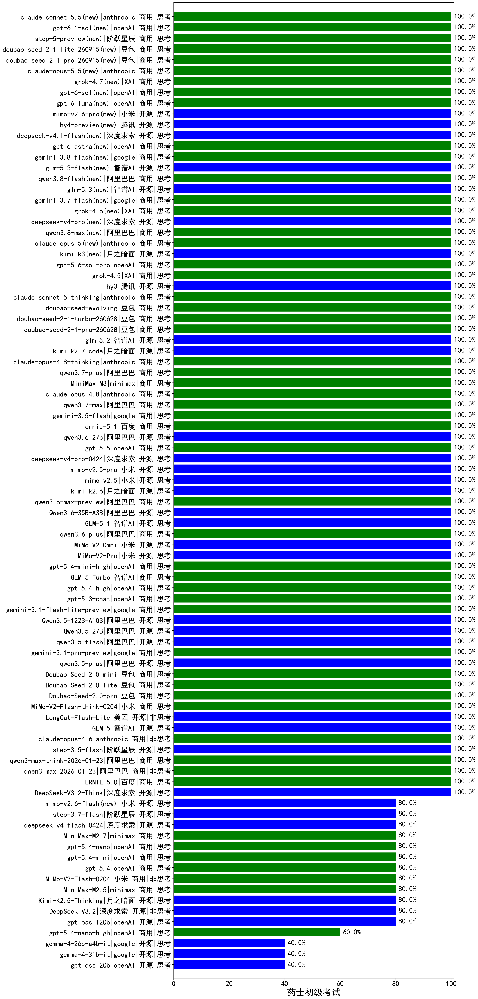

|类别|机构|大模型|【药士初级考试】准确率|平均耗时|平均消耗token|花费/千次（元）|排名（准确率）|
|---|---|-----|-------------------|-------|-----------|-----------|-----------|
|商用|豆包|doubao-seed-2-1-turbo-260628|100.0%|94s|2399|34.9|1|
|商用|openAI|gpt-6-astra(new)|100.0%|8s|187|45.5|2|
|商用|anthropic|claude-sonnet-5-thinking|100.0%|19s|743|47.2|3|
|开源|腾讯|hy3|100.0%|44s|159|0.5|4|
|商用|XAI|grok-4.5|100.0%|23s|748|24.3|5|
|商用|openAI|gpt-5.6-sol-pro|100.0%|7s|2433|149.0|6|
|开源|月之暗面|kimi-k3|100.0%|19s|374|26.8|7|
|商用|anthropic|claude-opus-5|100.0%|10s|498|75.2|8|
|商用|阿里巴巴|qwen3.8-max|100.0%|8s|367|10.9|9|
|开源|深度求索|deepseek-v4-pro|100.0%|10s|346|7.0|10|
|商用|XAI|grok-4.6|100.0%|791s|725|23.3|11|
|商用|google|gemini-3.7-flash|100.0%|5s|695|17.1|12|
|开源|智谱AI|glm-5.3(new)|100.0%|23s|637|16.6|13|
|商用|阿里巴巴|qwen3.8-flash(new)|100.0%|17s|369|0.8|14|
|开源|智谱AI|glm-5.3-flash(new)|100.0%|19s|752|2.0|15|
|商用|google|gemini-3.8-flash(new)|100.0%|16s|604|29.3|16|
|开源|深度求索|deepseek-v4.1-flash(new)|100.0%|2s|357|2.4|17|
|商用|豆包|doubao-seed-2-1-pro-260628|100.0%|191s|3063|89.6|18|
|开源|腾讯|hy4-preview(new)|100.0%|12s|630|10.5|19|
|开源|小米|mimo-v2.6-pro(new)|100.0%|14s|570|3.2|20|
|商用|openAI|gpt-6-luna(new)|100.0%|303s|207|0.5|21|
|商用|openAI|gpt-6-sol(new)|100.0%|167s|161|7.3|22|
|商用|XAI|grok-4.7(new)|100.0%|43s|2171|55.0|23|
|商用|anthropic|claude-opus-5.5(new)|100.0%|13s|583|71.9|24|
|商用|豆包|doubao-seed-2-1-pro-260915(new)|100.0%|53s|477|12.0|25|
|商用|豆包|doubao-seed-2-1-lite-260915(new)|100.0%|12s|433|1.0|26|
|商用|阶跃星辰|step-5-preview(new)|100.0%|13s|843|16.1|27|
|商用|openAI|gpt-6.1-sol(new)|100.0%|5s|185|9.0|28|
|商用|anthropic|claude-sonnet-5.5(new)|100.0%|9s|369|20.9|29|
|商用|google|gemini-4-argon(new)|100.0%|8s|402|47.0|30|
|商用|anthropic|claude-haiku-5.5(new)|100.0%|18s|523|1.6|31|
|商用|minimax|MiniMax-M3.1-Flash(new)|100.0%|42s|2677|10.0|32|
|商用|豆包|doubao-seed-evolving|100.0%|119s|3813|112.1|33|
|开源|月之暗面|kimi-k3.1-pro(new)|100.0%|21s|769|45.0|34|
|开源|月之暗面|kimi-k2.6|100.0%|33s|664|16.8|35|
|商用|google|gemini-3.1-flash-lite-preview|100.0%|17s|280|2.4|36|
|商用|阿里巴巴|qwen3.6-plus|100.0%|29s|1257|14.5|37|
|开源|阿里巴巴|Qwen3.5-27B|100.0%|233s|1489|6.9|38|
|商用|google|gemini-3.1-pro-preview|100.0%|16s|1012|82.2|39|
|开源|智谱AI|GLM-5.1|100.0%|123s|890|20.4|40|
|商用|百度|ERNIE-5.0|100.0%|170s|1629|38.3|41|
|开源|阿里巴巴|Qwen3.6-35B-A3B|100.0%|14s|1191|12.3|42|
|商用|阿里巴巴|qwen3.6-max-preview|100.0%|33s|1284|66.7|43|
|开源|智谱AI|glm-5.2|100.0%|27s|899|24.0|44|
|开源|小米|mimo-v2.5|100.0%|37s|905|9.3|45|
|开源|小米|mimo-v2.5-pro|100.0%|37s|854|13.7|46|
|开源|深度求索|DeepSeek-V3.2-Think|100.0%|181s|668|2.0|47|
|开源|深度求索|deepseek-v4-pro-0424|100.0%|16s|371|8.3|48|
|商用|openAI|gpt-5.5|100.0%|19s|229|35.7|49|
|开源|阿里巴巴|qwen3.6-27b|100.0%|19s|1243|21.5|50|
|商用|百度|ernie-5.1|100.0%|30s|628|10.6|51|
|商用|google|gemini-3.5-flash|100.0%|6s|983|58.9|52|
|商用|阿里巴巴|qwen3.7-max|100.0%|14s|610|20.6|53|
|商用|anthropic|claude-opus-4.8|100.0%|10s|374|53.5|54|
|商用|minimax|MiniMax-M3|100.0%|18s|531|6.1|55|
|商用|阿里巴巴|qwen3.7-plus|100.0%|19s|601|4.5|56|
|商用|anthropic|claude-opus-4.8-thinking|100.0%|18s|537|82.1|57|
|开源|月之暗面|kimi-k2.7-code|100.0%|50s|481|11.9|58|
|开源|阿里巴巴|Qwen3.5-122B-A10B|100.0%|111s|1711|10.6|59|
|开源|深度求索|DeepSeek-V3.2|80.0%|115s|286|0.8|60|
|开源|openAI|gpt-oss-120b|80.0%|3s|579|1.6|61|
|商用|minimax|MiniMax-M2.7|80.0%|21s|878|6.8|62|
|开源|小米|mimo-v2.6-flash(new)|80.0%|46s|661|1.3|63|
|开源|深度求索|deepseek-v4-flash-0424|80.0%|14s|576|1.1|64|
|开源|阶跃星辰|step-3.7-flash|80.0%|15s|973|7.5|65|
|开源|google|gemma-4-31b-it|40.0%|69s|459|1.2|66|
|开源|google|gemma-4-26b-a4b-it|40.0%|92s|571|1.5|67|
|开源|openAI|gpt-oss-20b|40.0%|7s|1384|1.5|68|

