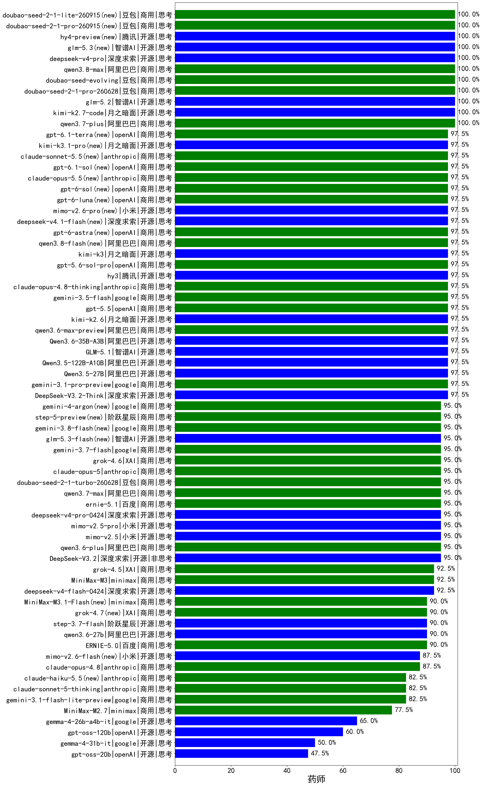

|类别|机构|大模型|【药师】准确率|平均耗时|平均消耗token|花费/千次（元）|排名（准确率）|
|---|---|-----|-------------------|-------|-----------|-----------|-----------|
|开源|深度求索|deepseek-v4-pro|100.0%|239s|681|16.0|1|
|开源|智谱AI|glm-5.2|100.0%|54s|1460|39.6|2|
|开源|腾讯|hy4-preview(new)|100.0%|51s|3325|59.0|3|
|商用|阿里巴巴|qwen3.7-plus|100.0%|19s|781|5.9|4|
|商用|豆包|doubao-seed-2-1-pro-260915(new)|100.0%|38s|643|17.0|5|
|商用|豆包|doubao-seed-2-1-lite-260915(new)|100.0%|26s|803|2.0|6|
|开源|月之暗面|kimi-k2.7-code|100.0%|20s|610|15.3|7|
|商用|阿里巴巴|qwen3.8-max|100.0%|16s|677|22.0|8|
|商用|豆包|doubao-seed-2-1-pro-260628|100.0%|203s|5115|151.2|9|
|开源|智谱AI|glm-5.3(new)|100.0%|50s|1405|38.1|10|
|商用|豆包|doubao-seed-evolving|100.0%|169s|4720|139.3|11|
|开源|小米|mimo-v2.6-pro(new)|97.5%|21s|769|4.4|12|
|开源|腾讯|hy3|97.5%|78s|180|0.5|13|
|商用|阿里巴巴|qwen3.8-flash(new)|97.5%|56s|1047|2.6|14|
|商用|openAI|gpt-5.6-sol-pro|97.5%|12s|2861|207.4|15|
|商用|openAI|gpt-6-astra(new)|97.5%|11s|201|51.6|16|
|商用|google|gemini-3.5-flash|97.5%|8s|1204|73.0|17|
|开源|深度求索|deepseek-v4.1-flash(new)|97.5%|11s|988|7.4|18|
|开源|月之暗面|kimi-k3|97.5%|28s|585|47.9|19|
|商用|anthropic|claude-opus-4.8-thinking|97.5%|15s|612|96.2|20|
|商用|openAI|gpt-6.1-terra(new)|97.5%|5s|254|7.0|21|
|商用|openAI|gpt-6-luna(new)|97.5%|196s|366|1.1|22|
|商用|openAI|gpt-6-sol(new)|97.5%|266s|189|9.5|23|
|开源|月之暗面|kimi-k3.1-pro(new)|97.5%|38s|1289|80.4|24|
|开源|深度求索|DeepSeek-V3.2-Think|97.5%|131s|916|2.7|25|
|商用|google|gemini-3.1-pro-preview|97.5%|33s|1190|97.4|26|
|开源|阿里巴巴|Qwen3.5-27B|97.5%|296s|2570|12.1|27|
|开源|阿里巴巴|Qwen3.5-122B-A10B|97.5%|242s|2435|15.2|28|
|商用|anthropic|claude-sonnet-5.5(new)|97.5%|7s|450|27.0|29|
|商用|openAI|gpt-6.1-sol(new)|97.5%|57s|185|9.3|30|
|开源|智谱AI|GLM-5.1|97.5%|110s|1229|28.5|31|
|开源|阿里巴巴|Qwen3.6-35B-A3B|97.5%|48s|1557|16.3|32|
|商用|阿里巴巴|qwen3.6-max-preview|97.5%|45s|1413|73.6|33|
|开源|月之暗面|kimi-k2.6|97.5%|82s|1372|35.9|34|
|商用|anthropic|claude-opus-5.5(new)|97.5%|12s|549|67.9|35|
|商用|openAI|gpt-5.5|97.5%|9s|340|59.8|36|
|商用|阶跃星辰|step-5-preview(new)|95.0%|20s|1035|19.9|37|
|开源|智谱AI|glm-5.3-flash(new)|95.0%|92s|1959|5.4|38|
|商用|google|gemini-3.8-flash(new)|95.0%|28s|626|30.5|39|
|商用|google|gemini-3.7-flash|95.0%|9s|681|16.7|40|
|商用|google|gemini-4-argon(new)|95.0%|20s|395|46.0|41|
|商用|XAI|grok-4.6|95.0%|259s|1490|55.4|42|
|商用|豆包|doubao-seed-2-1-turbo-260628|95.0%|131s|5247|77.6|43|
|商用|anthropic|claude-opus-5|95.0%|12s|560|87.0|44|
|商用|阿里巴巴|qwen3.7-max|95.0%|22s|796|27.2|45|
|开源|深度求索|DeepSeek-V3.2|95.0%|44s|306|0.9|46|
|商用|阿里巴巴|qwen3.6-plus|95.0%|30s|1410|16.3|47|
|开源|小米|mimo-v2.5|95.0%|115s|1049|11.3|48|
|开源|深度求索|deepseek-v4-pro-0424|95.0%|32s|700|16.2|49|
|商用|百度|ernie-5.1|95.0%|34s|782|13.4|50|
|开源|小米|mimo-v2.5-pro|95.0%|30s|1203|21.0|51|
|商用|minimax|MiniMax-M3|92.5%|20s|589|7.1|52|
|开源|深度求索|deepseek-v4-flash-0424|92.5%|38s|950|1.8|53|
|商用|XAI|grok-4.5|92.5%|79s|1222|44.2|54|
|商用|minimax|MiniMax-M3.1-Flash(new)|90.0%|19s|1118|3.7|55|
|商用|XAI|grok-4.7(new)|90.0%|50s|3643|116.8|56|
|开源|阶跃星辰|step-3.7-flash|90.0%|47s|1776|14.0|57|
|开源|阿里巴巴|qwen3.6-27b|90.0%|23s|1503|26.2|58|
|商用|百度|ERNIE-5.0|90.0%|207s|1626|38.2|59|
|商用|anthropic|claude-opus-4.8|87.5%|8s|429|64.1|60|
|开源|小米|mimo-v2.6-flash(new)|87.5%|151s|2773|5.5|61|
|商用|anthropic|claude-sonnet-5-thinking|82.5%|17s|700|44.6|62|
|商用|google|gemini-3.1-flash-lite-preview|82.5%|9s|289|2.5|63|
|商用|anthropic|claude-haiku-5.5(new)|82.5%|9s|676|2.1|64|
|商用|minimax|MiniMax-M2.7|77.5%|32s|1325|10.6|65|
|开源|google|gemma-4-26b-a4b-it|65.0%|56s|515|1.3|66|
|开源|openAI|gpt-oss-120b|60.0%|41s|667|1.9|67|
|开源|google|gemma-4-31b-it|50.0%|71s|437|1.1|68|
|开源|openAI|gpt-oss-20b|47.5%|11s|1946|2.2|69|

