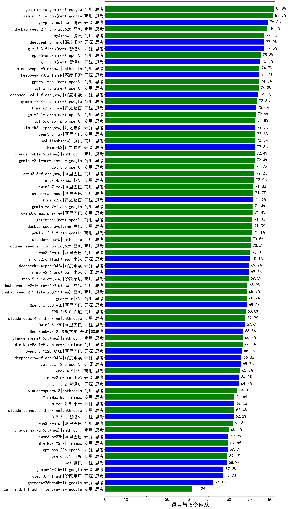

|类别|机构|大模型|【语言与指令遵从】准确率|平均耗时|平均消耗token|花费/千次（元）|排名（准确率）|
|---|---|-----|-------------------|-------|-----------|-----------|-----------|
|商用|google|gemini-4-argon(new)|81.6%|18s|377|33.7|1|
|商用|google|gemini-4-carbon(new)|81.3%|36s|1144|141.0|2|
|开源|腾讯|hy4-preview|78.8%|112s|7201|127.9|3|
|商用|豆包|doubao-seed-2-1-pro-260628|78.4%|239s|7536|221.7|4|
|商用|openAI|gpt-6.2-astra(new)|77.7%|41s|274|37.8|5|
|商用|腾讯|hy4(new)|77.1%|90s|4266|75.1|6|
|开源|深度求索|deepseek-v4-pro|77.0%|138s|2401|61.1|7|
|开源|智谱AI|glm-5.3-flash|77.0%|104s|3317|9.0|8|
|商用|openAI|gpt-6.2-sol(new)|76.8%|4s|281|10.0|9|
|商用|openAI|gpt-6-astra|75.3%|14s|342|71.3|10|
|开源|智谱AI|glm-5.3|75.0%|229s|5845|160.9|11|
|开源|深度求索|DeepSeek-V3.2-Think|74.7%|131s|1366|4.0|12|
|商用|anthropic|claude-opus-5.5(new)|74.7%|24s|710|73.0|13|
|商用|openAI|gpt-6.1-sol(new)|74.5%|6s|334|13.6|14|
|商用|openAI|gpt-6-luna|74.3%|224s|535|1.4|15|
|开源|深度求索|deepseek-v4.1-flash|74.1%|25s|2158|16.3|16|
|商用|google|gemini-3.8-flash|73.5%|20s|1332|63.7|17|
|开源|月之暗面|kimi-k2.7-code|73.0%|44s|1558|39.5|18|
|商用|openAI|gpt-6.1-terra(new)|72.9%|4s|353|7.5|19|
|商用|openAI|gpt-5.6-sol-pro|72.8%|23s|3364|233.7|20|
|开源|月之暗面|kimi-k3.1-pro(new)|72.7%|53s|1798|111.2|21|
|商用|阿里巴巴|qwen3.8-max|72.6%|41s|1835|61.9|22|
|商用|腾讯|hy4-flash(new)|72.5%|12s|1269|2.3|23|
|开源|月之暗面|kimi-k3|72.5%|75s|1690|152.2|24|
|商用|anthropic|claude-fable-5.2(new)|72.4%|28s|681|137.8|25|
|商用|google|gemini-3.1-pro-preview|72.4%|54s|3073|251.3|26|
|商用|openAI|gpt-5.5|72.2%|8s|485|71.4|27|
|商用|阿里巴巴|qwen3.8-flash|72.2%|41s|2118|5.4|28|
|商用|XAI|grok-4.7|72.0%|56s|4100|133.4|29|
|商用|阿里巴巴|qwen3.7-max|71.8%|33s|1862|63.8|30|
|商用|阿里巴巴|qwen4-max(new)|71.7%|26s|790|20.8|31|
|开源|月之暗面|kimi-k2.6|71.6%|98s|1814|46.4|32|
|商用|google|gemini-3.7-flash|71.4%|7s|814|18.3|33|
|商用|阿里巴巴|qwen3.6-max-preview|71.4%|55s|1722|86.9|34|
|商用|豆包|doubao-seed-evolving|71.3%|211s|6971|204.8|35|
|商用|openAI|gpt-6-sol|71.3%|140s|330|13.4|36|
|商用|google|gemini-3.5-flash|71.1%|10s|1785|104.7|37|
|商用|anthropic|claude-opus-5|70.5%|12s|846|115.2|38|
|商用|豆包|doubao-seed-2-1-turbo-260628|70.5%|165s|6541|95.9|39|
|商用|阿里巴巴|qwen3.6-plus|70.3%|42s|1874|21.1|40|
|开源|小米|mimo-v2.6-flash|70.1%|102s|1569|3.0|41|
|开源|深度求索|deepseek-v4-pro-0424|69.7%|34s|1055|23.8|42|
|开源|小米|mimo-v2.6-pro|69.6%|81s|2486|14.5|43|
|商用|阶跃星辰|step-5-preview(new)|69.5%|43s|2976|57.8|44|
|商用|豆包|doubao-seed-2-1-pro-260915(new)|68.9%|85s|2471|69.8|45|
|商用|豆包|doubao-seed-2-1-lite-260915(new)|68.7%|105s|4569|12.0|46|
|商用|XAI|grok-4.6|68.7%|227s|1977|73.2|47|
|开源|阿里巴巴|Qwen3.6-35B-A3B|68.6%|71s|1827|18.5|48|
|商用|百度|ERNIE-5.0|68.0%|137s|1834|41.8|49|
|商用|anthropic|claude-opus-4.8-thinking|67.9%|14s|1051|151.2|50|
|开源|阿里巴巴|Qwen3.5-27B|67.6%|285s|3634|16.9|51|
|开源|深度求索|DeepSeek-V3.2|66.8%|68s|388|1.0|52|
|商用|anthropic|claude-sonnet-5.5(new)|66.8%|13s|694|35.4|53|
|商用|minimax|MiniMax-M3.1-Flash(new)|66.8%|28s|1622|5.5|54|
|开源|阿里巴巴|Qwen3.5-122B-A10B|66.2%|353s|3614|22.4|55|
|开源|深度求索|deepseek-v4-flash-0424|66.0%|26s|1000|1.9|56|
|开源|openAI|gpt-oss-120b|65.7%|129s|689|1.7|57|
|商用|XAI|grok-4.5|65.3%|77s|1883|69.3|58|
|开源|小米|mimo-v2.5-pro|64.9%|32s|1755|31.4|59|
|开源|智谱AI|glm-5.2|64.8%|111s|5013|137.6|60|
|商用|anthropic|claude-opus-4.8|64.0%|8s|543|62.2|61|
|商用|minimax|MiniMax-M3|62.6%|64s|1766|26.0|62|
|开源|小米|mimo-v2.5|62.6%|21s|1446|15.9|63|
|商用|anthropic|claude-sonnet-5-thinking|62.4%|17s|758|39.9|64|
|开源|智谱AI|GLM-5.1|62.2%|206s|2519|58.1|65|
|商用|阿里巴巴|qwen3.7-plus|61.8%|72s|3891|30.3|66|
|商用|anthropic|claude-haiku-5.5(new)|60.0%|45s|854|2.3|67|
|开源|阿里巴巴|qwen3.6-27b|59.7%|33s|2012|34.2|68|
|商用|minimax|MiniMax-M2.7|59.6%|48s|1940|15.3|69|
|开源|openAI|gpt-oss-20b|59.3%|146s|1324|1.4|70|
|商用|百度|ernie-5.1|59.1%|36s|996|15.8|71|
|开源|腾讯|hy3|58.9%|64s|350|1.0|72|
|开源|google|gemma-4-31b-it|57.3%|46s|380|0.8|73|
|开源|阶跃星辰|step-3.7-flash|57.2%|28s|1634|12.3|74|
|开源|google|gemma-4-26b-a4b-it|52.1%|35s|442|0.9|75|
|商用|google|gemini-3.1-flash-lite-preview|42.2%|13s|362|2.5|76|

