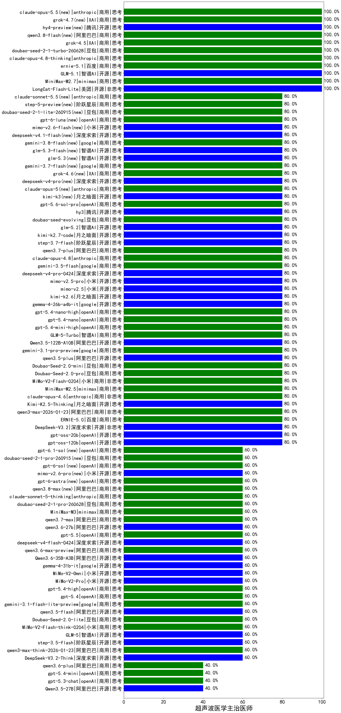

|类别|机构|大模型|【超声波医学主治医师】准确率|平均耗时|平均消耗token|花费/千次（元）|排名（准确率）|
|---|---|-----|-------------------|-------|-----------|-----------|-----------|
|商用|anthropic|claude-opus-4.8-thinking|100.0%|12s|812|126.8|1|
|商用|XAI|grok-4.7(new)|100.0%|36s|3369|104.9|2|
|商用|阿里巴巴|qwen3.8-flash(new)|100.0%|19s|1276|3.2|3|
|商用|百度|ernie-5.1|100.0%|58s|1325|23.0|4|
|开源|智谱AI|GLM-5.1|100.0%|75s|1811|42.2|5|
|开源|腾讯|hy4-preview(new)|100.0%|62s|3182|56.3|6|
|商用|XAI|grok-4.5|100.0%|118s|1556|57.8|7|
|商用|minimax|MiniMax-M2.7|100.0%|38s|1481|11.8|8|
|商用|anthropic|claude-opus-5.5(new)|100.0%|90s|709|86.8|9|
|商用|豆包|doubao-seed-2-1-turbo-260628|100.0%|124s|5246|77.4|10|
|商用|google|gemini-4-argon(new)|100.0%|23s|537|64.1|11|
|开源|腾讯|hy3|80.0%|59s|269|0.9|12|
|商用|XAI|grok-4.6|80.0%|40s|1874|71.2|13|
|商用|豆包|doubao-seed-evolving|80.0%|212s|6627|196.3|14|
|商用|openAI|gpt-5.6-sol-pro|80.0%|16s|3846|322.4|15|
|开源|openAI|gpt-oss-20b|80.0%|8s|1525|1.6|16|
|开源|月之暗面|kimi-k3|80.0%|35s|742|62.5|17|
|商用|anthropic|claude-opus-5|80.0%|15s|799|124.4|18|
|开源|深度求索|deepseek-v4-pro|80.0%|41s|1408|35.4|19|
|开源|openAI|gpt-oss-120b|80.0%|4s|813|2.3|20|
|商用|google|gemini-3.7-flash|80.0%|6s|830|20.2|21|
|开源|智谱AI|glm-5.3(new)|80.0%|49s|1856|50.4|22|
|开源|智谱AI|glm-5.2|80.0%|53s|2098|57.2|23|
|商用|google|gemini-3.8-flash(new)|80.0%|10s|805|39.2|24|
|开源|深度求索|deepseek-v4.1-flash(new)|80.0%|12s|1317|10.0|25|
|开源|小米|mimo-v2.6-flash(new)|80.0%|54s|1031|2.0|26|
|商用|openAI|gpt-6-luna(new)|80.0%|260s|568|1.7|27|
|商用|豆包|doubao-seed-2-1-lite-260915(new)|80.0%|32s|1381|3.6|28|
|商用|阶跃星辰|step-5-preview(new)|80.0%|13s|936|17.8|29|
|商用|anthropic|claude-sonnet-5.5(new)|80.0%|10s|582|34.5|30|
|开源|智谱AI|glm-5.3-flash(new)|80.0%|136s|5936|16.5|31|
|商用|minimax|MiniMax-M3.1-Flash(new)|80.0%|14s|862|2.7|32|
|开源|月之暗面|kimi-k2.7-code|80.0%|104s|1529|39.9|33|
|商用|百度|ERNIE-5.0|80.0%|219s|2517|59.4|34|
|开源|google|gemma-4-26b-a4b-it|80.0%|21s|625|1.6|35|
|开源|阶跃星辰|step-3.7-flash|80.0%|146s|3210|25.5|36|
|开源|阿里巴巴|Qwen3.5-122B-A10B|80.0%|158s|3341|21.0|37|
|开源|月之暗面|kimi-k2.6|80.0%|81s|1496|39.0|38|
|开源|小米|mimo-v2.5|80.0%|32s|1540|18.1|39|
|开源|小米|mimo-v2.5-pro|80.0%|33s|1485|26.7|40|
|开源|深度求索|deepseek-v4-pro-0424|80.0%|38s|811|18.7|41|
|商用|google|gemini-3.1-pro-preview|80.0%|69s|1562|127.8|42|
|商用|google|gemini-3.5-flash|80.0%|8s|1527|92.3|43|
|商用|anthropic|claude-opus-4.8|80.0%|8s|559|82.5|44|
|开源|深度求索|DeepSeek-V3.2|80.0%|46s|366|1.0|45|
|商用|阿里巴巴|qwen3.7-plus|80.0%|19s|935|7.0|46|
|开源|小米|mimo-v2.6-pro(new)|60.0%|52s|2280|13.5|47|
|商用|openAI|gpt-6.1-sol(new)|60.0%|7s|288|15.1|48|
|商用|豆包|doubao-seed-2-1-pro-260915(new)|60.0%|107s|1529|43.3|49|
|开源|深度求索|DeepSeek-V3.2-Think|60.0%|48s|1393|4.1|50|
|商用|anthropic|claude-haiku-5.5(new)|60.0%|11s|751|2.3|51|
|商用|openAI|gpt-6-sol(new)|60.0%|163s|244|12.0|52|
|商用|google|gemini-3.1-flash-lite-preview|60.0%|5s|426|3.8|53|
|开源|阿里巴巴|Qwen3.6-35B-A3B|60.0%|109s|1762|18.4|54|
|开源|google|gemma-4-31b-it|60.0%|69s|562|1.4|55|
|商用|openAI|gpt-6-astra(new)|60.0%|18s|317|85.9|56|
|商用|阿里巴巴|qwen3.6-max-preview|60.0%|51s|1625|84.5|57|
|开源|深度求索|deepseek-v4-flash-0424|60.0%|47s|695|1.3|58|
|商用|阿里巴巴|qwen3.8-max|60.0%|75s|3251|114.4|59|
|商用|openAI|gpt-5.5|60.0%|42s|970|187.8|60|
|开源|阿里巴巴|qwen3.6-27b|60.0%|41s|2053|35.9|61|
|商用|阿里巴巴|qwen3.7-max|60.0%|21s|1123|38.7|62|
|商用|anthropic|claude-sonnet-5-thinking|60.0%|19s|1143|73.9|63|
|商用|minimax|MiniMax-M3|60.0%|25s|674|8.4|64|
|商用|豆包|doubao-seed-2-1-pro-260628|60.0%|223s|7528|223.3|65|
|商用|阿里巴巴|qwen3.6-plus|40.0%|67s|1342|15.4|66|
|开源|阿里巴巴|Qwen3.5-27B|40.0%|388s|3618|17.1|67|

