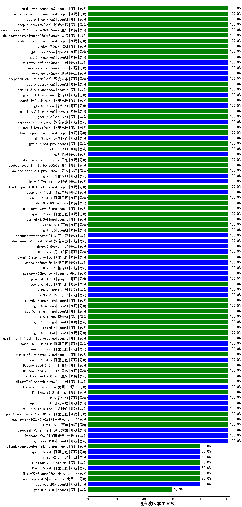

|类别|机构|大模型|【超声波医学主管技师】准确率|平均耗时|平均消耗token|花费/千次（元）|排名（准确率）|
|---|---|-----|-------------------|-------|-----------|-----------|-----------|
|开源|openAI|gpt-oss-120b|100.0%|4s|631|1.7|1|
|商用|豆包|doubao-seed-2-1-turbo-260628|100.0%|73s|2969|43.3|2|
|开源|腾讯|hy3|100.0%|51s|196|0.6|3|
|商用|XAI|grok-4.5|100.0%|109s|1721|64.8|4|
|商用|openAI|gpt-5.6-sol-pro|100.0%|13s|2845|196.4|5|
|开源|月之暗面|kimi-k3|100.0%|63s|715|60.0|6|
|商用|anthropic|claude-opus-5|100.0%|13s|683|105.5|7|
|商用|阿里巴巴|qwen3.8-max|100.0%|37s|498|15.3|8|
|开源|深度求索|deepseek-v4-pro|100.0%|13s|401|8.3|9|
|商用|XAI|grok-4.6|100.0%|46s|1568|58.3|10|
|商用|google|gemini-3.7-flash|100.0%|6s|960|23.8|11|
|开源|智谱AI|glm-5.3(new)|100.0%|28s|837|22.0|12|
|商用|阿里巴巴|qwen3.8-flash(new)|100.0%|11s|484|1.1|13|
|开源|智谱AI|glm-5.3-flash(new)|100.0%|25s|883|2.3|14|
|商用|google|gemini-3.8-flash(new)|100.0%|45s|683|33.0|15|
|商用|openAI|gpt-6-astra(new)|100.0%|7s|209|49.8|16|
|开源|深度求索|deepseek-v4.1-flash(new)|100.0%|5s|406|2.7|17|
|开源|腾讯|hy4-preview(new)|100.0%|25s|1208|20.8|18|
|开源|小米|mimo-v2.6-pro(new)|100.0%|42s|1639|9.6|19|
|开源|小米|mimo-v2.6-flash(new)|100.0%|60s|680|1.3|20|
|商用|openAI|gpt-6-luna(new)|100.0%|426s|348|1.0|21|
|商用|openAI|gpt-6-sol(new)|100.0%|208s|192|8.8|22|
|商用|XAI|grok-4.7(new)|100.0%|38s|3516|111.1|23|
|商用|anthropic|claude-opus-5.5(new)|100.0%|23s|548|65.3|24|
|商用|豆包|doubao-seed-2-1-pro-260915(new)|100.0%|20s|638|16.6|25|
|商用|豆包|doubao-seed-2-1-lite-260915(new)|100.0%|9s|567|1.4|26|
|商用|阶跃星辰|step-5-preview(new)|100.0%|20s|964|18.4|27|
|商用|openAI|gpt-6.1-sol(new)|100.0%|10s|200|9.3|28|
|商用|anthropic|claude-sonnet-5.5(new)|100.0%|8s|481|28.0|29|
|商用|google|gemini-4-argon(new)|100.0%|11s|480|56.6|30|
|商用|anthropic|claude-haiku-5.5(new)|100.0%|6s|692|2.1|31|
|商用|豆包|doubao-seed-evolving|100.0%|193s|4059|119.3|32|
|商用|豆包|doubao-seed-2-1-pro-260628|100.0%|133s|4551|134.0|33|
|开源|深度求索|deepseek-v4-pro-0424|100.0%|14s|415|9.2|34|
|商用|google|gemini-3.1-pro-preview|100.0%|25s|1205|97.8|35|
|商用|google|gemini-3.1-flash-lite-preview|100.0%|6s|381|3.4|36|
|商用|百度|ERNIE-5.0|100.0%|59s|1072|24.7|37|
|商用|阿里巴巴|qwen3.6-plus|100.0%|29s|1288|14.8|38|
|开源|google|gemma-4-31b-it|100.0%|19s|596|1.5|39|
|开源|google|gemma-4-26b-a4b-it|100.0%|43s|577|1.5|40|
|开源|智谱AI|GLM-5.1|100.0%|137s|1171|26.9|41|
|开源|阿里巴巴|Qwen3.6-35B-A3B|100.0%|104s|1317|13.6|42|
|商用|阿里巴巴|qwen3.6-max-preview|100.0%|39s|1316|67.9|43|
|开源|月之暗面|kimi-k2.6|100.0%|396s|1026|26.4|44|
|开源|智谱AI|glm-5.2|100.0%|37s|1530|41.4|45|
|开源|小米|mimo-v2.5-pro|100.0%|19s|938|15.3|46|
|开源|深度求索|deepseek-v4-flash-0424|100.0%|24s|597|1.1|47|
|开源|阿里巴巴|Qwen3.5-122B-A10B|100.0%|79s|1845|11.4|48|
|商用|openAI|gpt-5.5|100.0%|21s|332|55.1|49|
|开源|深度求索|DeepSeek-V3.2-Think|100.0%|19s|601|1.7|50|
|商用|百度|ernie-5.1|100.0%|18s|743|12.5|51|
|商用|google|gemini-3.5-flash|100.0%|8s|1274|76.7|52|
|商用|阿里巴巴|qwen3.7-max|100.0%|18s|834|28.3|53|
|商用|anthropic|claude-opus-4.8|100.0%|13s|547|81.7|54|
|商用|minimax|MiniMax-M3|100.0%|26s|577|6.8|55|
|商用|阿里巴巴|qwen3.7-plus|100.0%|19s|844|6.3|56|
|开源|阶跃星辰|step-3.7-flash|100.0%|85s|1307|10.1|57|
|商用|anthropic|claude-opus-4.8-thinking|100.0%|11s|694|107.4|58|
|开源|深度求索|DeepSeek-V3.2|100.0%|30s|251|0.7|59|
|开源|月之暗面|kimi-k2.7-code|100.0%|71s|652|16.3|60|
|开源|openAI|gpt-oss-20b|80.0%|13s|1276|1.4|61|
|开源|小米|mimo-v2.5|80.0%|35s|1636|19.4|62|
|开源|阿里巴巴|Qwen3.5-27B|80.0%|300s|2342|10.9|63|
|商用|minimax|MiniMax-M2.7|80.0%|32s|1209|9.5|64|
|开源|阿里巴巴|qwen3.6-27b|80.0%|27s|1610|27.9|65|
|商用|anthropic|claude-sonnet-5-thinking|80.0%|26s|742|46.4|66|
|商用|minimax|MiniMax-M3.1-Flash(new)|80.0%|54s|1342|4.6|67|

