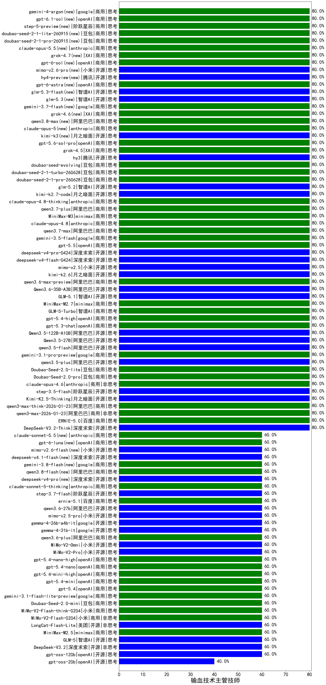

|类别|机构|大模型|【输血技术主管技师】准确率|平均耗时|平均消耗token|花费/千次（元）|排名（准确率）|
|---|---|-----|-------------------|-------|-----------|-----------|-----------|
|开源|深度求索|deepseek-v4-pro-0424|80.0%|29s|639|14.4|1|
|开源|腾讯|hy4-preview(new)|80.0%|62s|2330|40.9|2|
|商用|openAI|gpt-6-astra(new)|80.0%|14s|249|61.5|3|
|开源|智谱AI|glm-5.3-flash(new)|80.0%|24s|951|2.5|4|
|开源|智谱AI|GLM-5.1|80.0%|195s|1483|34.2|5|
|开源|阿里巴巴|Qwen3.6-35B-A3B|80.0%|106s|1760|18.2|6|
|商用|阿里巴巴|qwen3.6-max-preview|80.0%|51s|1593|82.1|7|
|开源|月之暗面|kimi-k2.6|80.0%|63s|1080|27.6|8|
|开源|小米|mimo-v2.5|80.0%|15s|1128|12.1|9|
|开源|智谱AI|glm-5.3(new)|80.0%|23s|804|20.9|10|
|开源|深度求索|deepseek-v4-flash-0424|80.0%|17s|494|0.9|11|
|商用|google|gemini-3.7-flash(new)|80.0%|10s|1058|26.0|12|
|商用|openAI|gpt-5.5|80.0%|6s|334|54.2|13|
|商用|XAI|grok-4.6(new)|80.0%|24s|1034|35.6|14|
|商用|google|gemini-3.5-flash|80.0%|10s|1759|106.3|15|
|商用|阿里巴巴|qwen3.7-max|80.0%|23s|1212|41.5|16|
|商用|anthropic|claude-opus-4.8|80.0%|12s|499|71.8|17|
|商用|minimax|MiniMax-M3|80.0%|15s|501|5.4|18|
|商用|阿里巴巴|qwen3.7-plus|80.0%|37s|1753|13.5|19|
|商用|阿里巴巴|qwen3.8-max(new)|80.0%|41s|2052|70.9|20|
|商用|anthropic|claude-opus-4.8-thinking|80.0%|23s|660|100.1|21|
|开源|月之暗面|kimi-k2.7-code|80.0%|15s|426|9.9|22|
|开源|智谱AI|glm-5.2|80.0%|30s|1263|33.7|23|
|商用|豆包|doubao-seed-2-1-pro-260628|80.0%|96s|4440|130.2|24|
|商用|豆包|doubao-seed-2-1-turbo-260628|80.0%|135s|5535|81.5|25|
|商用|豆包|doubao-seed-evolving|80.0%|352s|5510|162.3|26|
|商用|anthropic|claude-opus-5(new)|80.0%|12s|647|97.7|27|
|开源|腾讯|hy3|80.0%|58s|218|0.6|28|
|商用|XAI|grok-4.5|80.0%|148s|1011|34.6|29|
|开源|月之暗面|kimi-k3(new)|80.0%|30s|532|40.8|30|
|商用|minimax|MiniMax-M2.7|80.0%|19s|863|6.6|31|
|开源|小米|mimo-v2.6-pro(new)|80.0%|16s|799|4.5|32|
|商用|anthropic|claude-opus-5.5(new)|80.0%|15s|833|104.0|33|
|商用|google|gemini-4-argon(new)|80.0%|17s|410|44.8|34|
|开源|深度求索|DeepSeek-V3.2-Think|80.0%|36s|1150|3.4|35|
|商用|百度|ERNIE-5.0|80.0%|260s|2482|58.2|36|
|商用|阿里巴巴|qwen3-max-2026-01-23|80.0%|61s|663|6.0|37|
|商用|阿里巴巴|qwen3-max-think-2026-01-23|80.0%|305s|2496|24.3|38|
|开源|月之暗面|Kimi-K2.5-Thinking|80.0%|287s|1469|29.5|39|
|开源|阶跃星辰|step-3.5-flash|80.0%|12s|1102|2.2|40|
|商用|anthropic|claude-opus-4.6|80.0%|10s|624|92.9|41|
|商用|openAI|gpt-6.1-sol(new)|80.0%|7s|241|11.8|42|
|商用|阶跃星辰|step-5-preview(new)|80.0%|7s|507|9.1|43|
|商用|豆包|doubao-seed-2-1-lite-260915(new)|80.0%|12s|559|1.3|44|
|商用|豆包|doubao-seed-2-1-pro-260915(new)|80.0%|112s|706|18.2|45|
|商用|豆包|Doubao-Seed-2.0-pro|80.0%|280s|1146|16.7|46|
|商用|豆包|Doubao-Seed-2.0-lite|80.0%|163s|751|2.3|47|
|商用|openAI|gpt-5.6-sol-pro|80.0%|13s|2943|209.8|48|
|商用|openAI|gpt-5.3-chat|80.0%|4s|357|27.2|49|
|商用|google|gemini-3.1-pro-preview|80.0%|79s|2391|197.7|50|
|开源|阿里巴巴|qwen3.5-flash|80.0%|388s|3500|6.8|51|
|开源|阿里巴巴|Qwen3.5-27B|80.0%|174s|2990|14.0|52|
|开源|阿里巴巴|Qwen3.5-122B-A10B|80.0%|325s|2657|16.5|53|
|商用|XAI|grok-4.7(new)|80.0%|63s|3936|128.4|54|
|开源|阿里巴巴|qwen3.5-plus|80.0%|45s|3467|16.3|55|
|商用|openAI|gpt-6-sol(new)|80.0%|603s|168|6.7|56|
|商用|openAI|gpt-5.4-high|80.0%|11s|488|43.2|57|
|商用|智谱AI|GLM-5-Turbo|80.0%|46s|1136|23.6|58|
|商用|google|gemini-3.8-flash(new)|60.0%|13s|910|44.2|59|
|开源|深度求索|deepseek-v4.1-flash(new)|60.0%|39s|939|6.9|60|
|商用|openAI|gpt-6-luna(new)|60.0%|262s|267|0.7|61|
|开源|小米|mimo-v2.6-flash(new)|60.0%|31s|720|1.4|62|
|商用|阿里巴巴|qwen3.8-flash(new)|60.0%|90s|5478|14.5|63|
|商用|anthropic|claude-sonnet-5.5(new)|60.0%|8s|644|38.8|64|
|开源|深度求索|deepseek-v4-pro(new)|60.0%|59s|712|16.5|65|
|开源|openAI|gpt-oss-120b|60.0%|48s|440|1.1|66|
|商用|anthropic|claude-sonnet-5-thinking|60.0%|10s|552|32.5|67|
|商用|openAI|gpt-5.4-mini-high|60.0%|161s|696|19.5|68|
|开源|深度求索|DeepSeek-V3.2|60.0%|98s|276|0.8|69|
|开源|智谱AI|GLM-5|60.0%|62s|2188|38.3|70|
|商用|minimax|MiniMax-M2.5|60.0%|28s|1285|10.1|71|
|开源|美团|LongCat-Flash-Lite|60.0%|440s|423|0.0|72|
|商用|小米|MiMo-V2-Flash-0204|60.0%|124s|542|1.0|73|
|商用|小米|MiMo-V2-Flash-think-0204|60.0%|552s|3344|6.9|74|
|商用|豆包|Doubao-Seed-2.0-mini|60.0%|540s|2301|4.4|75|
|商用|google|gemini-3.1-flash-lite-preview|60.0%|12s|307|2.5|76|
|商用|openAI|gpt-5.4|60.0%|5s|271|20.5|77|
|商用|openAI|gpt-5.4-mini|60.0%|8s|187|3.5|78|
|商用|openAI|gpt-5.4-nano|60.0%|136s|256|1.6|79|
|开源|阶跃星辰|step-3.7-flash|60.0%|26s|2255|17.7|80|
|商用|openAI|gpt-5.4-nano-high|60.0%|10s|431|3.1|81|
|开源|小米|MiMo-V2-Pro|60.0%|406s|1093|18.3|82|
|开源|小米|MiMo-V2-Omni|60.0%|364s|1439|16.4|83|
|商用|阿里巴巴|qwen3.6-plus|60.0%|34s|1652|18.9|84|
|开源|google|gemma-4-31b-it|60.0%|97s|536|1.3|85|
|开源|google|gemma-4-26b-a4b-it|60.0%|81s|526|1.3|86|
|开源|小米|mimo-v2.5-pro|60.0%|13s|977|15.8|87|
|开源|阿里巴巴|qwen3.6-27b|60.0%|27s|1800|31.1|88|
|商用|百度|ernie-5.1|60.0%|20s|853|14.2|89|
|商用|anthropic|claude-haiku-5.5(new)|60.0%|5s|707|2.2|90|
|开源|openAI|gpt-oss-20b|40.0%|8s|633|0.6|91|

