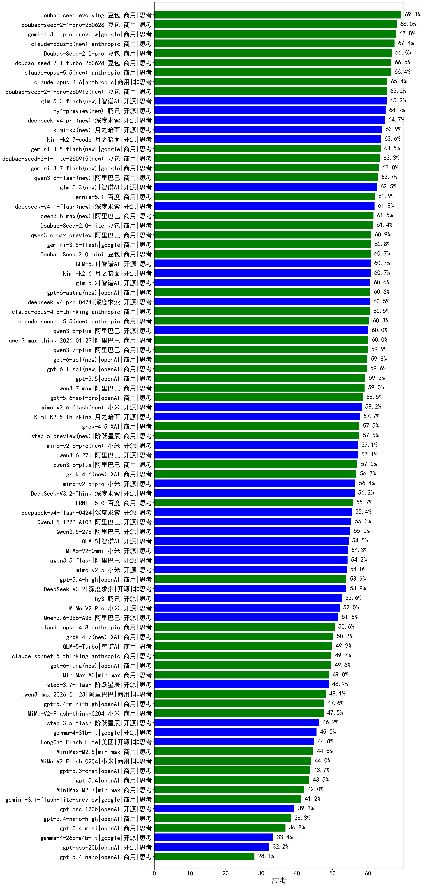

|类别|机构|大模型|【高考】准确率|平均耗时|平均消耗token|花费/千次（元）|排名（准确率）|
|---|---|-----|-------------------|-------|-----------|-----------|-----------|
|商用|豆包|doubao-seed-evolving|69.3%|323s|13345|394.4|1|
|商用|google|gemini-4-argon(new)|68.7%|20s|873|95.7|2|
|商用|豆包|doubao-seed-2-1-pro-260628|68.0%|346s|14348|424.6|3|
|商用|google|gemini-3.1-pro-preview|67.8%|66s|3731|302.3|4|
|商用|anthropic|claude-opus-5|67.4%|17s|1173|160.7|5|
|商用|豆包|doubao-seed-2-1-turbo-260628|66.5%|272s|11713|172.8|6|
|商用|anthropic|claude-opus-5.5(new)|66.4%|19s|1017|106.6|7|
|商用|豆包|doubao-seed-2-1-pro-260915(new)|65.2%|110s|3048|85.6|8|
|开源|智谱AI|glm-5.3-flash(new)|65.2%|191s|7398|20.3|9|
|开源|腾讯|hy4-preview(new)|64.9%|128s|7555|133.5|10|
|开源|深度求索|deepseek-v4-pro|64.7%|117s|3797|97.7|11|
|开源|月之暗面|kimi-k3|63.9%|116s|2430|221.3|12|
|开源|月之暗面|kimi-k2.7-code|63.6%|83s|3211|82.7|13|
|商用|google|gemini-3.8-flash(new)|63.5%|20s|1670|78.7|14|
|商用|豆包|doubao-seed-2-1-lite-260915(new)|63.3%|117s|3764|9.7|15|
|商用|google|gemini-3.7-flash|63.0%|12s|1324|30.3|16|
|商用|阿里巴巴|qwen3.8-flash(new)|62.7%|98s|5848|15.3|17|
|开源|智谱AI|glm-5.3(new)|62.5%|195s|6768|185.4|18|
|商用|百度|ernie-5.1|61.9%|63s|2523|42.5|19|
|开源|深度求索|deepseek-v4.1-flash(new)|61.8%|32s|3221|24.5|20|
|商用|阿里巴巴|qwen3.8-max|61.5%|114s|5043|175.7|21|
|商用|阿里巴巴|qwen3.6-max-preview|60.9%|111s|3519|180.8|22|
|商用|google|gemini-3.5-flash|60.8%|18s|3032|179.8|23|
|开源|智谱AI|GLM-5.1|60.7%|287s|4725|109.8|24|
|开源|月之暗面|kimi-k2.6|60.7%|258s|5239|136.9|25|
|开源|智谱AI|glm-5.2|60.6%|123s|5724|156.1|26|
|商用|openAI|gpt-6-astra(new)|60.6%|17s|563|131.8|27|
|开源|深度求索|deepseek-v4-pro-0424|60.5%|103s|3388|79.0|28|
|商用|anthropic|claude-opus-4.8-thinking|60.5%|21s|1766|264.6|29|
|商用|anthropic|claude-sonnet-5.5(new)|60.3%|9s|941|48.0|30|
|商用|阿里巴巴|qwen3.7-plus|59.9%|109s|5972|46.5|31|
|商用|openAI|gpt-6-sol(new)|59.8%|241s|528|23.9|32|
|商用|openAI|gpt-6.1-sol(new)|59.6%|14s|512|22.8|33|
|商用|openAI|gpt-5.5|59.2%|26s|1198|210.6|34|
|商用|阿里巴巴|qwen3.7-max|59.0%|65s|3558|123.2|35|
|商用|openAI|gpt-5.6-sol-pro|58.5%|33s|5728|511.8|36|
|开源|小米|mimo-v2.6-flash(new)|58.2%|247s|4266|8.3|37|
|商用|XAI|grok-4.5|57.5%|99s|5015|199.2|38|
|商用|阶跃星辰|step-5-preview(new)|57.5%|62s|4666|90.8|39|
|开源|小米|mimo-v2.6-pro(new)|57.1%|155s|6283|37.1|40|
|开源|阿里巴巴|qwen3.6-27b|57.1%|70s|4713|81.8|41|
|商用|阿里巴巴|qwen3.6-plus|57.0%|84s|4109|47.3|42|
|商用|XAI|grok-4.6|56.7%|230s|4046|158.5|43|
|开源|小米|mimo-v2.5-pro|56.4%|82s|4359|85.1|44|
|开源|深度求索|DeepSeek-V3.2-Think|56.2%|190s|3256|9.6|45|
|商用|百度|ERNIE-5.0|55.7%|289s|4821|112.3|46|
|开源|深度求索|deepseek-v4-flash-0424|55.4%|70s|2732|5.3|47|
|开源|阿里巴巴|Qwen3.5-122B-A10B|55.3%|442s|6735|42.0|48|
|开源|阿里巴巴|Qwen3.5-27B|55.0%|457s|6685|31.2|49|
|商用|minimax|MiniMax-M3.1-Flash(new)|54.3%|64s|4094|15.2|50|
|开源|小米|mimo-v2.5|54.0%|55s|3506|44.0|51|
|开源|深度求索|DeepSeek-V3.2|53.9%|88s|960|2.7|52|
|开源|腾讯|hy3|52.6%|75s|597|1.8|53|
|开源|阿里巴巴|Qwen3.6-35B-A3B|51.6%|84s|3875|40.0|54|
|商用|anthropic|claude-opus-4.8|50.6%|10s|866|107.1|55|
|商用|XAI|grok-4.7(new)|50.2%|135s|9747|368.9|56|
|商用|anthropic|claude-sonnet-5-thinking|49.7%|26s|2006|122.7|57|
|商用|openAI|gpt-6-luna(new)|49.6%|218s|1127|3.3|58|
|商用|minimax|MiniMax-M3|49.0%|135s|4047|63.3|59|
|开源|阶跃星辰|step-3.7-flash|48.9%|82s|6128|48.3|60|
|商用|anthropic|claude-haiku-5.5(new)|46.2%|10s|1337|3.8|61|
|开源|google|gemma-4-31b-it|45.5%|111s|888|2.1|62|
|商用|minimax|MiniMax-M2.7|42.0%|106s|4569|37.0|63|
|商用|google|gemini-3.1-flash-lite-preview|41.2%|18s|726|5.8|64|
|开源|openAI|gpt-oss-120b|39.3%|96s|1245|3.3|65|
|开源|google|gemma-4-26b-a4b-it|33.4%|96s|1096|2.6|66|
|开源|openAI|gpt-oss-20b|32.2%|127s|2141|2.2|67|

